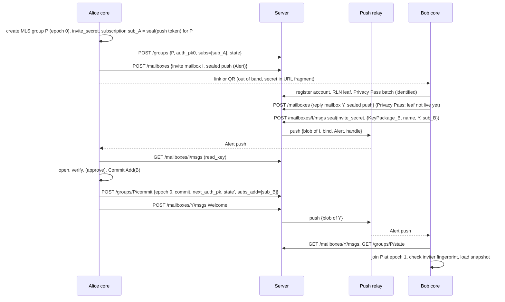
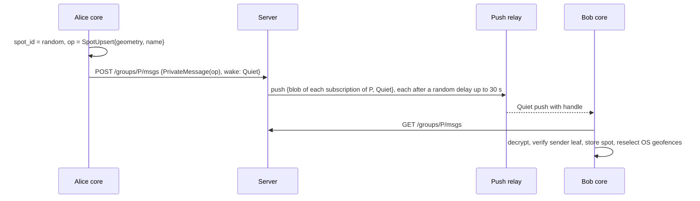
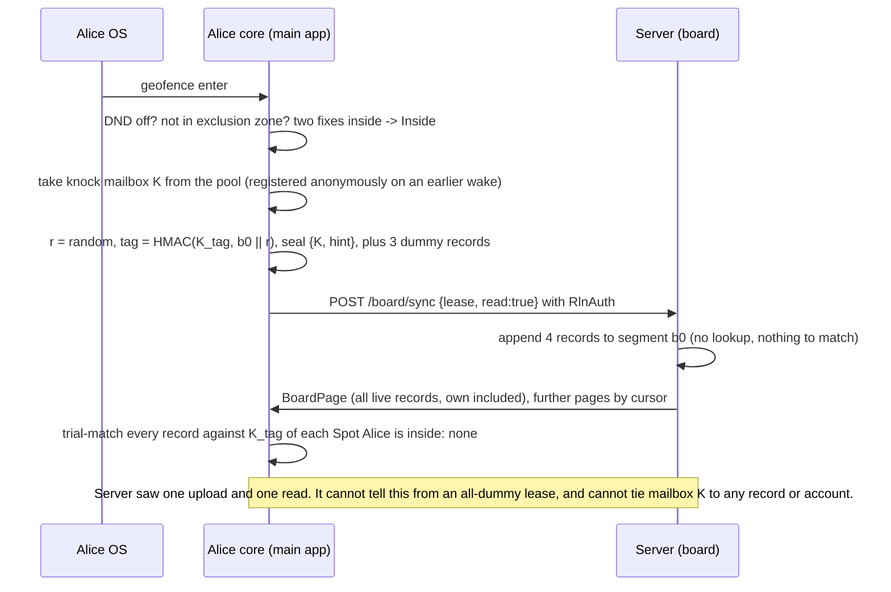
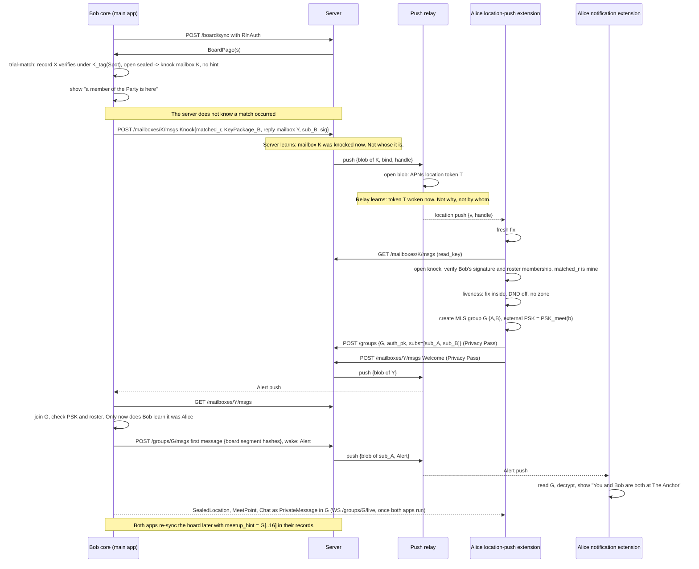
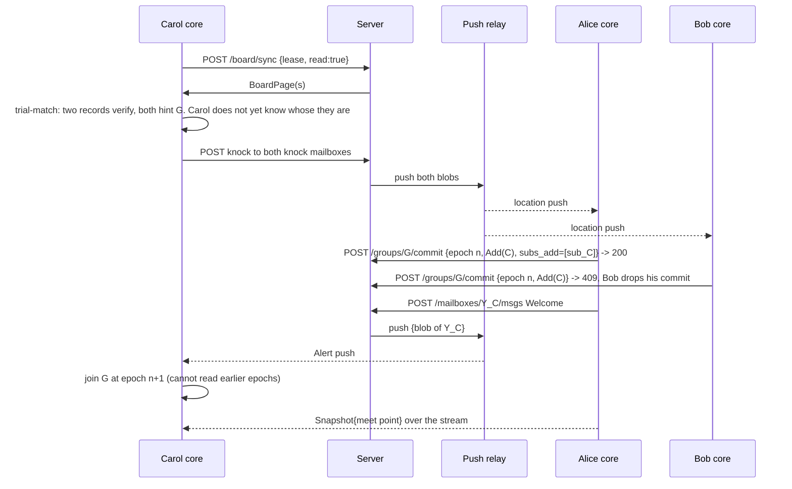
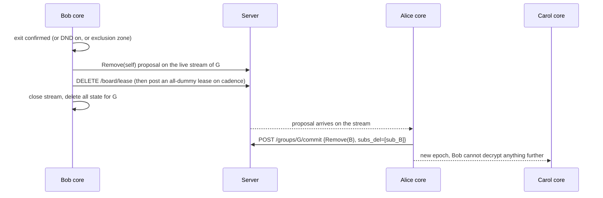
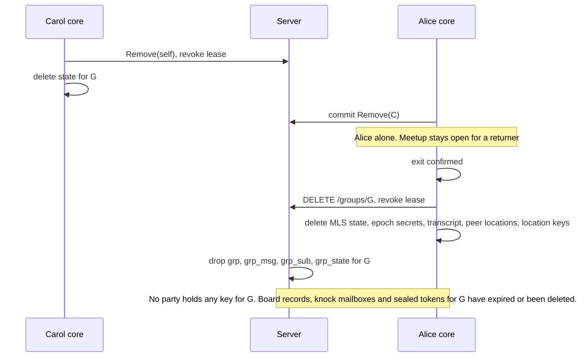

# Pingers: cryptographic design, data model and API

Status: design proposal, 2026-11-12, revision 6. No code exists yet. This revision describes a single initial release: blind board, membership proofs, anonymous mailboxes woken through sealed push tokens and a separate push relay, exact-location consent and pluggable transport ship together. Mechanisms that can fail on a device or server have a named runtime fallback; optional modes are settings. Earlier revisions staged the design as v1 and v2 and tried decoy wakes (oblivious message retrieval, fuzzy message detection, uniform ticks); those were dropped (B.4.9, H.2). Crate, paper and draft facts were spot-checked by web search on this date; items I could not confirm are marked "unverified" or "estimate".

## 0. Summary of the chosen design

One design, shipped as the initial release. There are no stages. Where a mechanism can fail on a particular device or server, a **runtime fallback** with a stated trigger takes over, and the app's "What your server sees" screen says so. **Settings** are user or Party choices.

| Concern | Initial release | Runtime fallback (trigger) or setting |
|---|---|---|
| Party group keys | MLS (RFC 9420) via `openmls`, one group per Party. Handshake messages sent as `PrivateMessage`. | None |
| Co-presence detection | **Blind board.** Each slot is `(r, tag, sealed beacon)` with fresh random `r` and `tag = HMAC(K_spot, bucket ‖ r)[..16]`. No two records are equal, so the server matches nothing. The uploading device downloads the live board and trial-matches it against its own Spots. | Setting: "Low data" reads the board only on entry |
| Hiding "in a Spot or not", Spot count, DND | Every upload is exactly 4 records; unused ones are random bytes. DND, exclusion zone and "outside all Spots" are the same wire state (all dummies). | None |
| Knock (telling the people already there) | The matched record's sealed reply address names a one-time, anonymously registered **mailbox**. The knocker posts a sealed knock to it anonymously. No decoys. | None |
| Waking the knocked device | **Sealed push token and a separate push relay.** The mailbox carries the owner's push token encrypted to the relay. The server passes the blob to the relay, which sends a content-free push. The server never sees the device; the relay never sees the mailbox. | Setting: **"No wake-up pushes (maximum privacy)"**: no token registered; the device finds knocks on its own wakes, minutes to an hour later |
| Liveness check on a knock | iOS: Location Push Service Extension takes a fresh fix. Android: high-priority FCM message, short background run. | iOS fallback if the location-push entitlement or "Always" permission is missing: Notification Service Extension with the last known fix, or a background push to the app |
| Group fan-out | Subscriber lists of sealed push tokens, one per member per group; no accounts | None |
| Meetup live channel | **Chunked OHTTP** (draft-ietf-ohai-chunked-ohttp-08, IESG-approved Proposed Standard): one long-lived, incrementally encrypted exchange per member through the OHTTP relay. The server never sees a member's IP. | Split channel (streamed downlink, ordinary OHTTP uplink) if the relay cannot stream full duplex |
| Meetup keys | A fresh MLS group per Meetup, KeyPackage carried in the knock, bound to the Spot by an external PSK. Leaving is an MLS Remove; ending deletes all group state. | None |
| Exact position inside a Meetup | Per-member location key, HPKE-granted only to approved members (B.6.1) | Setting: AskEachTime / Everyone / Nobody |
| Anonymous rate limiting | **Membership proof with rate-limiting nullifier** (RLN-v2, Groth16), proved in the main app only. Requests made from an app extension spend pre-fetched **Privacy Pass** tokens (RFC 9576/9578). | Fallback: Privacy Pass for everything while a new device's leaf is not yet live, if the prover is too slow on a device, or if the operator disables proofs |
| Transport | Pluggable (B.12): OHTTP relay, **mandatory** for anonymous and stream traffic; no "no relay" mode | None: without a reachable relay, anonymous traffic waits |
| Post-quantum | TLS: X25519MLKEM768 via rustls/aws-lc-rs. MLS: suite 0x0003 default. | Setting: X-Wing suite per Party |
| Storage | Server: a handful of tables of opaque bytes; board in memory only. Push relay: no database. Client: SQLCipher, key in Keychain/Keystore. | None |

Four services: the **Pingers server** (self-hosted), the **OHTTP relay** (hides IP addresses from the server), the **push relay** (hides push tokens from the server) and the **map host** (serves whole region map packs; B.12, "Map host"). For official app builds the push relay and the default map host are run by the app publisher (B.4.9).

Definitions used throughout:

- **Bucket**: a 15-minute window, `b = floor(unix_seconds / 900)`.
- **Record**: 96 opaque bytes on the board: `r` (16), `tag` (16), sealed board beacon (64). Only a Party member who holds the right Spot key can recognise it.
- **Slot**: one record position in an upload. Every upload has exactly 4.
- **Lease**: one upload of 4 records, live for the bucket it was posted in and the next 3 (60 minutes).
- **Board beacon**: the sealed 48 bytes inside a record. It carries the id of a one-time knock mailbox and a Meetup hint. It does **not** name the poster.
- **Mailbox**: an anonymous drop on the server, addressed by a random 16-byte id. Anyone who knows the id can post to it; only the holder of its read key can read it. No account is attached.
- **Sealed push token**: a device's push token encrypted to the push relay, fresh for every mailbox and every group subscription.
- **Knock**: the signed message a newcomer posts to the knock mailbox of a matched record to start or join a Meetup. It names the knocker (to the poster only) and carries a fresh KeyPackage.

---

## A. Threat model and privacy goals

### A.1 Adversaries

1. **Honest-but-curious operator**, possibly compelled to hand over the database, logs and future traffic.
2. **Malicious server**: drops, reorders, replays, forges traffic; creates accounts; lies about time; tries to learn locations.
3. **Network observer**, **push providers** (Apple, Google), and the two relay operators: the **OHTTP relay** and the **push relay** (for official builds, the app publisher). Each relay is assumed not to collude with the server operator.
4. **Malicious or curious Party member**: holds Party keys and Spot geometry legitimately.
5. **Removed Party member**: held keys up to some epoch.
6. **Device thief** / forensic examiner.

### A.2 What each learns

**Pingers server (honest-but-curious).** Columns: the release default (OHTTP relay and push relay run by parties other than the server operator); the "No wake-up pushes" setting; and a custom build whose operator runs both the server and the push relay.

| Fact | Release default | Setting: no wake-up pushes | Custom build: server operator runs the push relay |
|---|---|---|---|
| Names, phone numbers, emails | No (none collected) | No | No |
| Pseudonymous accounts, connection times of identified requests (registration, daily token batch) | Yes | Yes | Yes |
| Push tokens | **No**: only blobs sealed to the relay | None exist | **Yes** |
| Party names, Spot names or geometry, number of Spots | No | No | No |
| Chat text, meet point, live locations | No | No | No |
| Whether an unmatched user is in a Spot, on DND, or in an exclusion zone | No | No | No |
| Equal values on the board, match events, collision counts | **No** (blind board) | No | No |
| Board volume: record count per bucket, upload and read timing, which 4 records arrived together, lease replacement chains | Yes, but not per user | Same | Same |
| That a knock happened: mailbox X was posted to at time t | Yes | Yes | Yes |
| **Which device was knocked** | **No.** The mailbox has no account, and its push token is sealed. | No, and nothing is woken | **Yes**, by push token |
| Who knocked | No: the sender is anonymous | No | No from the knock; by push token once the Welcome wakes the knocker |
| Where, which Spot, which Party | No | No | No |
| That a Meetup formed, when, and how many members | Yes: a new group with n subscriptions | Yes | Yes |
| Who is in a Meetup | **No.** The live channel arrives through the relay, so the server sees n anonymous channels for group G and no IPs. No stored list of accounts. | Same | Push tokens of the members |
| Party membership graph | **Not stored.** Each group has n sealed subscriptions that cannot be tied to accounts or to each other. | Not stored, and no subscriptions | **Yes**, as a graph over push tokens |

**Push relay**, default and the case where one third party runs both relays:

| Fact | Push relay, separate operator | One third party runs the OHTTP relay and the push relay |
|---|---|---|
| Push token T was woken at time t; class (location, alert, quiet); which Pingers server asked | Yes | Yes |
| Which tokens are woken together, by timing: members of a group on a Commit, the two sides of an accepted knock | Yes, if it logs | Yes |
| Device IP addresses and the timing of their board uploads | No | **Yes**: IP, token and wake time for the same device |
| Mailbox ids, groups, Parties, accounts | No | No |
| Board contents, knocks, any message | No | No |
| Who knocked | No | No (an IP, by timing) |

**Apple and Google** see that a device received a Pingers push at a time, and on iOS that it was a location push. This cannot be avoided with platform push; the "No wake-up pushes" setting removes it. Payloads carry no content.

Other cases:

- **No "no relay" mode** (decided 2026-11-13): anonymous and stream traffic always goes through an OHTTP relay, and the gateway accepts encapsulated requests only from configured relays, so the server never sees a device IP on them.
- **Privacy Pass in place of membership proofs** changes nothing above; the server sees each account's daily token issuance.
- **Official builds**: the push relay is the app publisher's. The publisher sees wake times for every token on every server that uses the official app.

Requirement 11 said the server may learn that two or more people share an area but not which. The server here learns less: it cannot see co-presence on the board, and a knock tells it only that an anonymous mailbox was used.

**Honest residual leaks**

- **The split is an assumption, not a proof.** Server and push relay together know which device is knocked and which devices share a group. Collusion, or one operator running both, returns the design to "the server knows who meets whom, not where". Severity: high if it happens; the app shows who runs what.
- **Push relay timing.** A relay that logs can cluster tokens that are woken together and so recover Party and Meetup membership over push tokens. It does not know accounts, servers' contents, or anything about Spots. For official builds this party is the publisher. Severity: medium. `Quiet` fan-out is jittered by up to 30 seconds to blur it; knocks and alerts are not.
- **Meetup live-channel timing.** The live channel runs over chunked OHTTP through the relay, so the server no longer sees members' IPs. Server and OHTTP relay together could pair IPs with groups by timing (the same non-collusion assumption as all anonymous traffic). Severity: low.
- **Event structure without identities.** The server sees that a knock, a Welcome and a new group of n happened at time t, and how long the group lived. Severity: low.
- **Lease chains.** A lease upload names the lease it replaces (to prove the right to delete it), so consecutive leases of one device form a pseudonymous chain. Severity: low to medium. See H.3.
- **Mailbox registration timing.** Mailboxes are registered one per request on separate wakes, but an operator watching arrival times behind the relay can still guess which belong together. Severity: low.
- Upload timing correlates with phone movement (uploads piggyback on OS wakes).
- A user who goes on DND while inside a Meetup visibly leaves it (to members).

What stays protected even if server and push relay collude: where anyone is, which Spots and how many exist, who is in a Spot without a match, DND and exclusion-zone state, exact positions, and all content.

**Malicious server, additional attempts and outcome**

| Attack | Outcome |
|---|---|
| Inject a fake Party member | Fails. Adds require a Commit from an existing member; external commits and external proposals are disabled; no server-run KeyPackage directory exists to poison. Invite KeyPackages are MACed under the invite secret, which never reaches the server. |
| Inject a fake Spot | Fails. Spot changes are MLS application messages signed by a member's leaf key. |
| Forge a board record | Fails. A record matches only if its tag verifies under a Spot key the server does not hold. A random record matches with probability 2⁻¹²⁸ per trial. |
| Replay an old record | Fails. The tag and the sealing key bind the record's start bucket; readers reject records older than 4 buckets; the knock mailbox in an old record has expired. |
| Forge or replay a knock | Fails. The knock is sealed under a key derived from the Spot key and the record, and signed by a Party member's leaf key over the record it answers. A garbage knock costs the knocked device one wake. |
| Move a sealed push token to another mailbox, to wake a chosen device on a chosen event | Fails. The blob is bound to its mailbox through the HPKE `info`; the relay cannot open it under another binding. |
| Replay a sealed push token to wake a device repeatedly | Possible until the blob's expiry, within the relay's per-token rate limit. The device wakes, finds nothing new, and does nothing. Battery cost only. |
| Substitute its own push relay key, to read tokens | Detected. The relay key is pinned in the app and in the Party's encrypted state. |
| Serve a partial board, or different boards to different readers | Readers miss matches (denial of service). It is also a probe: serve reader B only record X and watch whether a mailbox is knocked. That reveals that an anonymous upload and an anonymous mailbox share a Spot; still not who or where. Detection: members compare board segment hashes inside Meetups (B.4.3). |
| Skew client time | Client uses its own clock, accepts server offset only within ±120 s, otherwise refuses to post and warns. |
| Withhold or delay | Denial of service only. Always possible. |
| Forge a membership proof or reuse a nullifier | Fails under Groth16 soundness; affects rate limiting only. A subverted trusted setup would break rate limiting, not anonymity (B.4.8). |
| Collude with a Party member | Gains exactly what that member has: Spot geometry and the ability to recognise that Party's records (see A.3). |

**OHTTP relay operator.** Sees client IP, request times and encrypted sizes; not content, not accounts. Board reads are large (B.4.3), so the relay can tell a board read from a small request. It must not be the server operator.

### A.3 What Party members learn

- Roster, display names, Spot geometry (by design).
- That *some* member is at Spot S: the official app shows this only for a Spot you are inside (client rule, B.4.3). A member running a modified client could still learn anonymous counts for any Spot by downloading the board and trial-matching (see below).
- That member X is at Spot S: only by knocking on X's record and being answered, or by being knocked by X. Either way the other side learns about them too.
- Precise live location of X only inside a Meetup both are in.
- Not: X's location outside Spots, X's other Parties, X's exclusion zones, whether X is on DND (indistinguishable from "not there", subject to the leak above).

**Proof of presence is not solved, and cannot be fully.** Any Party member holds every Spot's key without being there, so can recognise that Spot's records on the board and can post one. Stated plainly: *a Party is a trust circle; Spots are places where members agree to be discoverable by each other.* Mitigations chosen:

- **Silent reading yields counts, not names.** The server cannot make reading conditional on posting: it does not know which records belong together, so reading is a plain download. To compensate, board records do not name their poster (B.4.2). A member who reads silently learns how many Party members are at each Spot, and nothing about who.
- **Names cost a signed knock.** To learn who is there a member must knock, and a knock is signed, so the occupant learns the knocker's name first and can decline.
- **Squatting is the remaining gap.** A member can post records for Spots they are not in and collect the knocks of real arrivals, learning their names without answering. Arrivals see `UnansweredKnock` (B.4.4). The per-bucket rate limit caps how many Spots one device can squat on.
- **Liveness check at knock time** removes stale presence, not lies.
- Optional later: BLE or UWB proximity confirmation between Meetup members before precise location is shown ("verified nearby"). Raises the bar; relay attacks remain.
- Device attestation (App Attest, Play Integrity) is rejected as a mitigation: it attests the binary, not the GPS, and is incompatible with self-built clients.

**Removed member**: MLS removal rotates the exporter, so tags for later epochs are not computable. A lagging member who has not yet processed the removal still posts old-epoch records for up to one lease (60 min); the removed member can recognise those, and could knock, but a knock signed by a leaf that the occupant has since seen removed is rejected. Bounded; mitigated by a wake on every Commit.

### A.4 Stolen device

Database is SQLCipher-encrypted; the key sits in Keychain (`AfterFirstUnlockThisDeviceOnly`, required for background wakes) or is wrapped by an Android Keystore key. A locked-since-boot device exposes nothing. A device unlocked once and then exploited exposes: Party keys, roster, Spot geometry, exclusion zones (sensitive: likely home), any live Meetup. It does not expose: past Meetups (keys and transcript deleted at end), location history (core never stores one). It also exposes the RLN secret (lets the thief post as that device until the leaf is zeroed) and the read keys of its live mailboxes (lets the thief read knocks addressed to it until they expire). Remedy: any member removes the lost device, rotating Party keys; the owner deletes the account, which zeroes the leaf; its mailboxes and sealed tokens expire by themselves.

---

## B. Cryptographic design

### B.1 Identity and accounts

- No phone number or email. An **account** is an Ed25519 key generated on device; `account_id = SHA-256(pk)[..16]`.
- The same key is the MLS `BasicCredential` signature key for that device's leaf in each Party. (Per-Party signature keys would hide cross-Party identity from members; deferred, see H.3.)
- One device per account in the initial release. Device migration is an encrypted export, not a second leaf.
- Self-hosted servers can require an operator-issued registration code to stop open signups.
- Optional out-of-band verification: 60-digit safety number over both parties' leaf keys, shown in the roster.

### B.2 Party group: MLS

**Chosen: MLS (RFC 9420) with OpenMLS.**

| Option | Verdict |
|---|---|
| MLS / OpenMLS | Chosen. Standardised, formally analysed, asynchronous adds, forward secrecy and post-compromise security, exporter interface for deriving application keys, maintained Rust implementation. |
| Signal Sender Keys (pairwise Double Ratchet + sender key) | Works for small groups but removal costs O(n) pairwise sends, no group-wide exporter, more bespoke code. |
| Static group key shared in invite | Simplest, but no removal and no post-compromise security. Rejected. |
| `mls-rs` (AWS) | Viable alternative implementation; OpenMLS preferred for X-Wing support and persistence traits. |

Configuration:

- Ciphersuite default `MLS_128_DHKEMX25519_CHACHA20POLY1305_SHA256_Ed25519` (0x0003). Opt-in X-Wing suite, see B.8.
- All handshake messages as `PrivateMessage`. The cleartext header still exposes `group_id`, `epoch`, `content_type`, which is exactly what the server needs to order Commits.
- External commits, external proposals and external senders: disabled.
- Application messages in the Party group carry only **Party state operations** (roster profiles and Spot create/edit/delete). There is no Party-wide chat in the initial release.
- Every member sends an Update at least every 7 days when online (post-compromise security).
- New members cannot read history under MLS, so the committer uploads an encrypted **state snapshot** with each Commit: `XChaCha20-Poly1305(MLS-Exporter("pingers/v1/state", epoch), snapshot)`.

**Server access control without membership knowledge**: each epoch all members derive an Ed25519 keypair from `MLS-Exporter("pingers/v1/log-auth", group_id, 32)`. The committer sends the next epoch's public key with the Commit; the server stores it and requires a signature by it on reads and writes of that group log. Removed members cannot derive the new key.

### B.3 Private co-presence detection: options

| Option | Server learns | Rounds / battery | Fit |
|---|---|---|---|
| (a) Deterministic keyed-hash Spot tokens; server matches equal values | Equality of opaque values, so match events and collision counts | One upload; no interaction | First draft of this design. Superseded by (a′). |
| **(a′) Blind board: randomised keyed tags, client-side trial matching** | Record counts and timing only. No equality, no matches. | One upload plus one board download; O(records × Spots) HMACs on the phone | **Chosen.** Costs bandwidth that grows with the number of devices (B.4.3). |
| (b) OPRF / PSI tags (RFC 9497 VOPRF) | Same as (a), or less with full PSI | Extra round trip per evaluation; PSI is pairwise and interactive | OPRF protects low-entropy inputs when clients share no secret. Here members already share a 256-bit MLS secret, so it adds cost and nothing else. If the server holds the OPRF key it can brute-force low-entropy inputs anyway. |
| (c) Keyed geohash/H3 cell tokens with neighbour cells | Equality, plus number of cells | 9 tokens per fix; boundary fuzz | Useful with no predefined fences. Pingers has explicit Spots whose geometry clients evaluate exactly, so a Spot id is a strictly better input. Keep in mind for a future "anywhere nearby" mode. |
| (d) Private proximity testing (Narayanan et al., NDSS 2011), threshold PSI, homomorphic distance | Nothing, in the ideal | Pairwise, O(n²), both sides online or a heavy server protocol | Solves a harder problem (hiding location from *friends*) that Pingers does not have. Battery-hostile. |
| (e) TEE (SGX/TDX/SEV/Nitro) | Nothing if the enclave holds | One upload | Self-hosters lack hardware and attestation chains; side-channel history; shifts trust to a vendor. Rejected. |
| (f) Private information retrieval over the board | Nothing | Heavy server compute per read, large client keys | Would remove the board download. Too costly for a self-hosted box today; revisit if the board outgrows (a′). |

Why (a′) over (a): with deterministic tokens the server sees every match the moment it happens and can count how many people share each opaque value. With randomised tags the board is a list of unrelated-looking 96-byte strings. The price is that matching moves to the phone, which must download the board.

### B.4 The presence protocol

#### B.4.1 Derivations

For Party group at epoch `e`, Spot `spot_id` (16 random bytes), start bucket `b0`, record randomness `r` (16 random bytes, fresh per record):

```
PR_e        = MLS-Exporter(label="pingers/v1/presence", context=party_id, len=32)
K_spot      = HKDF-Expand(PR_e,   "spot" || spot_id, 32)
K_tag       = HKDF-Expand(K_spot, "tag", 32)
tag(b0, r)  = HMAC-SHA256(K_tag,  be64(b0) || r)[..16]
K_seal(b0)  = HKDF-Expand(K_spot, "seal" || be64(b0), 32)
PSK_meet(b) = HKDF-Expand(K_spot, "psk"  || be64(b), 32)
K_knock(b0, r) = HKDF-Expand(K_seal(b0), "knock" || r, 32)
```

Properties: every record is unlinkable to every other without `K_spot`, including two records for the same Spot in the same bucket; keys rotate automatically on every membership change; removed members lose them. The bucket does not provide unlinkability (the random `r` does); it bounds replay and sets the lease lifetime.

#### B.4.2 Lease and record format

Each upload is exactly `N = 4` records, live for `L = 4` buckets starting at the current one.

```rust
struct Lease {                       // 424 B
    b0: u64,                         // start bucket (public: it is just the time)
    records: [Record; 4],
    revoke_commit: [u8; 32],         // SHA-256(revoke_key)
}
struct Record {                      // 96 B, fixed, independent of MLS ciphersuite
    r:      [u8; 16],
    tag:    [u8; 16],                // tag(b0, r), or random
    sealed: [u8; 64],                // board beacon, or random
}
struct BoardBeacon {                 // 48 B plaintext
    reply:       [u8; 32],           // knock mailbox id (16 B) || 16 reserved zero bytes
    meetup_hint: [u8; 16],           // first 16 bytes of the Meetup group id, or zero
}
```

`sealed = XChaCha20-Poly1305(K_seal(b0), nonce = r || 0⁸, aad = "pingers/v1/board" || be64(b0) || r || tag, pt = BoardBeacon)`. The nonce is derived from `r`, which is unique per record with overwhelming probability, so no nonce bytes are stored. The tag doubles as a key commitment: ChaCha20-Poly1305 alone is not key-committing, and readers try several keys.

- Real record: one per Spot the device is currently confirmed inside (across all Parties). Dummy record: 96 random bytes. The two are indistinguishable without `K_spot`.
- If the device is inside more than 4 Spots, the core picks the 4 with the most recent peer activity and rotates the rest in on refresh.
- Record order is shuffled per upload.

**The board beacon does not name the poster.** Reading the blind board is a plain download that the server cannot tie to a deposit, so anything a record reveals to Party members is revealed to a member who reads silently. A record therefore reveals only "some member of this Party is at this Spot". Identity is exchanged in the knock, where the knocker goes first and signs (B.4.4). It also keeps the record small, which matters because every device downloads every record.

The **knock**:

```rust
struct Knock {                       // XChaCha20-Poly1305 under K_knock(b0, r) of the matched record,
                                     // random 24-byte nonce; padded to 1 KiB (4 KiB for X-Wing)
    matched_r: [u8; 16],             // the record being answered; stops re-use against another record
    my_r: Option<[u8; 16]>,          // knocker's own record for this Spot, for tie-breaks
    leaf_index: u32,                 // knocker's leaf in the Party group
    party_epoch: u64,
    key_package: Vec<u8>,            // fresh MLS KeyPackage for the Meetup group, same credential
    reply_mailbox: [u8; 16],         // knocker's one-time mailbox for the Welcome
    meetup_sub: Option<Subscription>, // knocker's sealed push subscription for the Meetup group (B.4.9)
    sig: [u8; 64],                   // leaf key over ("pingers/v1/knock", party_id, epoch, spot_id,
                                     //  b0, matched_r, H(key_package), reply_mailbox, H(meetup_sub))
}
```

Only a Party member can derive `K_knock`, so only a Party member can produce a knock the poster will open; the signature then says which member. The server stores the knock as opaque bytes.

#### B.4.3 The board: a dumb store, client-side matching

The server matches nothing. The board is an append-and-expire list of 96-byte records, grouped into one **segment** per start bucket and held in memory:

```rust
board:  BTreeMap<u64 /*b0*/, Segment { records: Vec<[u8; 96]>, revoked: BitVec }>
leases: HashMap<LeaseId, (RevokeCommit, u64 /*b0*/, [u32; 4] /*positions*/)>
```

A segment is dropped when bucket `b0 + 4` starts. The live board is the 4 newest segments, minus revoked records.

**Protocol.** One call, `POST /v1/board/sync`, appends the caller's lease and returns the first page of the live board, taken *after* the append. Further pages come from `GET /v1/board/page`.

- **Post, then read.** Because every device posts before it reads, of any two devices in the same Spot at least one sees the other's record, whatever the interleaving.
- **Trial matching.** For each record the core computes `tag(b0, r)` under `K_tag` for every Spot it is currently `Inside` (at most 4), for the current Party epoch and, during the grace period of B.4.7, the previous one. At most 8 HMACs per record, each two SHA-256 compressions with the key state precomputed. About 0.2 µs each on a phone with SHA extensions (estimate): 4,000 records take under 10 ms, 40,000 take 50 to 100 ms. On a tag match the core opens `sealed` and proceeds to the knock. Its own records are skipped by `r`.
- **Client rule: match only where you are** (decided 2026-11-13). The core trial-matches records only against Spots whose state is `Inside` (F.2), never against other Spots of the Party. Concretely:
  - `K_tag` for a Spot is derived only when that Spot enters `Inside` and is zeroised when it leaves, so an honest core cannot compute matches elsewhere.
  - A board download made for cover (`cover_read_ratio`) or while no Spot is `Inside` is discarded unmatched.
  - The core API exposes no occupancy, count or "active" signal for any Spot the device is not inside. The only presence signals the UI receives are a knock outcome or a Meetup for the Spot it is in.
  - This is a client rule, not a cryptographic guarantee: every member holds the Party exporter, so a modified client can still derive any Spot's key and count anonymous records (A.3, I.2 #15). The rule makes silent reading a deliberate act of a modified app rather than something the official app does or shows.
- The honest core matches only against Spots it is inside and not suppressed in. A modified client could match against all of its Party's Spots; see A.3 for what that yields.
- **Paging.** Records are returned as raw concatenated bytes (`application/octet-stream`, no per-record framing), oldest segment first, in pages of at most 2,730 records (256 KiB). Each page carries the segment boundaries and a server-MACed cursor for the next page, valid 10 minutes. Segments are append-only, so a cursor stays valid while new records arrive; records appended after the first page are picked up by the final page. One rate-limit proof covers the whole read.
- **Transparency hook.** Each page includes `SHA-256` over each fully closed segment it contains. Members put the hashes they saw into the first Meetup message; a mismatch raises `Notice::BoardEquivocation`. This detects, after the fact and only among people who meet, a server that shows different boards to different readers.

**Size and scaling.** Every device holds one live lease (the cover policy guarantees it), so the live board is about `devices × 4 × 96 B`. A device reads it on every lease upload, about 32 times a day.

| Devices | Live records | One read | Per device per day | Server egress per day |
|---|---|---|---|---|
| 100 | 400 | 38 KB | 1.2 MB | 0.12 GB |
| 1,000 | 4,000 | 384 KB | 12 MB | 12 GB |
| 5,000 | 20,000 | 1.9 MB | 61 MB | 307 GB |
| 10,000 | 40,000 | 3.8 MB | 123 MB | 1.2 TB |

Cost per device grows linearly with the number of devices and server egress grows with its square. Around 1,000 devices this is fine: 12 MB a day is less than a few minutes of music streaming, and a read fits easily in a background wake. It breaks somewhere between 3,000 and 5,000 devices: reads pass 1 MB, which is unreliable inside a 30-second background wake on a poor connection, daily mobile data passes 40 MB, and egress passes 100 GB a day, all of which a relay must also carry. Phone CPU is not the limit; bandwidth is.

Levers, in the order to pull them:

1. **Cover-read ratio.** The server advertises `cover_read_ratio = q` (default 1). A routine cover upload reads the board with probability `q`; a confirmed entry always reads. At `q = 0.25` data falls about 4×. Cost: an upload with a read becomes weaker cover for an entry (roughly 4× weaker at 0.25).
2. **"Low data" setting** (per user): read only on confirmed entry and after a Party epoch change. The server, or the relay, can then tell when the device entered *some* Spot, by the large response.
3. **Sharded board**: records carry a public shard number `HMAC(K_spot, "shard" || day)[..k bits]`; dummies pick a random shard; a reader fetches exactly 4 shards. Cuts reads by `2ᵏ / 4`. Leak: two records in different shards are known not to share a Spot, which gives back part of the matching signal. Not in the release; specified here so the record format can grow a shard byte later.
4. Beyond that, PIR (option f) or several servers.

**What the server still learns from the board**: how many records arrive per bucket (four per upload, so the number of uploads), when each upload and read happens, which 4 records came together, and which lease a new lease replaces. It cannot tell real from dummy, cannot see two records as related, and cannot count how many people share a Spot.

#### B.4.4 Knock and liveness check

Every device keeps a small pool of one-time mailboxes (B.4.9), registered anonymously and one per request on earlier wakes, so that registering one never coincides with using it and the server cannot group them. Each real board record names one of them as its knock mailbox.

When trial matching finds one or more records for a Spot B is inside:

1. B opens each matched board beacon. It learns a knock mailbox id and a Meetup hint, not a name. B's app can already show "a member of <Party> is here".
2. B posts a **knock** (B.4.2) to up to 3 of the knock mailboxes, preferring records that carry a `meetup_hint`. The post is anonymous: through the OHTTP relay, with a membership proof. B is in the main app at this point (a geofence event woke it), so it can prove.
3. The server stores the knock. If the mailbox has a sealed push token, the server hands it to the **push relay**, which wakes the owner A: a location push on iOS, a high-priority data message on Android (B.4.9, B.7). The server does not know whose mailbox it is; the relay does not know why it is pushing.
4. A's device wakes, reads the mailbox with its read key, opens the knock, verifies B's signature against the Party roster at `party_epoch` and that `matched_r` is one of A's own live records. Then it **re-validates its own state**: fresh location fix inside the Spot, not on DND, not in an exclusion zone. This is what makes 60-minute leases safe: a stale lease produces a decline, not a false Meetup.
5. **Accept**: A creates the Meetup group, or adds B to the one it is in (B.5), and posts the MLS Welcome to the `reply_mailbox` named in the knock, which wakes B the same way. **Decline**: A sends nothing. B's client surfaces nothing.
6. **Tie-break.** If A and B posted at the same moment and each found the other, both knock. A device that receives a knock from a peer it has also knocked compares `my_r` values: the smaller creates the group, the other waits.
7. **Re-knock and unanswered knock.** While both stay, B knocks again at each of its board syncs if the record has been refreshed. If nothing is answered within one lease, B's core raises `Notice::UnansweredKnock` for that Spot. The cause may be a stale lease, a decline, a device with wake-up pushes turned off that has not woken yet, or a member squatting on the Spot to harvest knocks (A.3). The core cannot tell which.

Time from arrival to Meetup: a few seconds by default, set by push delivery and the location fix.

**Setting: "No wake-up pushes (maximum privacy)".** The device registers its mailboxes and group subscriptions with no push token at all. Nothing can wake it. It finds knocks only when it wakes by itself: geofence dwell and exit events, iOS background refresh (scheduled by the OS, often 15 to 60 minutes apart or more), Android WorkManager (at least 15 minutes apart), or the user opening the app. On each such wake it reads its knock mailboxes. A knock stays in the mailbox for the lease (60 minutes), so a later wake still finds it, and the knocker re-knocks while both remain. The new arrival sees "a member of <Party> is here" at once, without a name; the Meetup forms when the other device next wakes. The server and the push relay learn nothing about wakes for that device. Cost: minutes to an hour of latency, and a visit shorter than the gap between wakes may be missed.

**What the server learns from a knock.** That mailbox X was knocked at time t. Not which device or account owns X, not its push token, not who knocked, not where, not which Spot or Party. If the knock is accepted it also sees a Welcome posted to another mailbox and a new group with two subscriptions: "a Meetup of two formed", still without accounts. **What the push relay learns.** That push token T was woken at time t, and what kind of push it was. Not the mailbox, the Party, anything on the board, or who knocked. Both views together identify the device that was knocked, which is why the two must not be run by the same party (B.4.9).

Who reveals first, between members: the knocker. B names itself, with a signature, to whoever posted the record, before learning who that is. The poster reveals itself only by answering. The alternative, a named and signed record on the board, would let every Party member read who is where without leaving a trace.

#### B.4.5 Padding, cover traffic and cadence

- Record count and size are constant (4 × 96 B), so the server cannot count Spots or tell whether any record is real. Dummies are random bytes; on the blind board even two real records for the same Spot look unrelated, so dummies hide the *number* of real records. A dummy record's mailbox field is random and names nothing.
- **Cover policy**: the core posts a lease (and reads the board, subject to `cover_read_ratio`) at every wake of the main app (geofence event, significant location change, background refresh, Android WorkManager run), with minimum spacing 20 minutes and target spacing 45 minutes. It posts immediately, ignoring spacing, in three cases: confirmed entry to a Spot, and exit or suppression (DND, exclusion zone) while holding a real record.
- True fixed-rate upload is not achievable on iOS in the background, so cadence is "opportunistic with a floor". An off-cadence upload signals "some state changed", not which kind.
- The "Low data" setting (B.4.3) may also disable cover uploads; the UI must say that the server can then tell when the device is in some Spot.

#### B.4.6 Uniform behaviour

Client behaviour visible to the server is independent of whether a record was real. Every upload is followed by the same read. Matching is local. Knocks are sent only for records whose tag and seal verify, which requires a true match. A device woken without a valid knock does nothing. A decline is silence, so the server cannot distinguish "declined" from "could not be woken" or "pushes turned off".

#### B.4.7 Epoch lag

Tags depend on the Party epoch. A device that has not processed the newest Commit computes different keys. Rules:

- Before every board sync the core pulls and processes the Party group logs.
- Every Commit wakes the group's subscribers quietly (or is found at their next own wake); on wake the core re-posts its lease.
- **Readers bridge the gap.** For one lease horizon after an epoch change that was **not** a removal, a reader trial-matches with both the current and the previous epoch's keys. After a removal there is no grace: a lagging poster is invisible until it syncs (fails safe).

#### B.4.8 Anonymous authorisation: membership proofs, and Privacy Pass in extensions

Board syncs, mailbox registrations and knocks must not carry an account, yet must be rate-limited. They travel through the OHTTP relay (B.12), so the server does not see the IP either, and carry one of two credentials.

| Credential | Used for | Where it is produced |
|---|---|---|
| **Membership proof** (RLN-v2) | Board syncs, mailbox registration, knocks, group creation: everything the main app sends | Main app only. Proving needs tens of MB and up to a second of CPU. |
| **Privacy Pass token** | Every anonymous request made from the Location Push or Notification Service Extension (Welcome, group creation and Commit while answering a knock), and all requests on devices in fallback | Fetched by the main app in a daily batch; spending one is a table lookup |

**Why proofs for the main path.** A request proves "I am one of the devices registered on this server, and this is at most my k-th request of this kind in this bucket" without saying which device. Limits apply per 15-minute bucket instead of per day, so a member cannot stockpile tokens and squat on every Spot for an hour or flood a mailbox with knocks; a removed or banned device loses access within two hours instead of keeping its issued tokens.

**Why not proofs in extensions.** iOS app extensions are limited to about 24 MB of memory and 30 seconds. A Groth16 prover with its proving key does not fit reliably. Tokens do.

**Options for the proof.**

| Construction | Proof size | Prover (phone) | Setup | Verdict |
|---|---|---|---|---|
| **RLN-v2 circuit, Groth16 over BN254, Poseidon Merkle tree depth 20** (`zerokit` `rln` crate, arkworks) | 128 B proof; 265 B with public inputs | Estimated 0.15 to 0.3 s on a recent iPhone, 0.5 to 1 s on a mid-range Android | Circuit-specific trusted setup | **Chosen.** Maintained Rust code, used by Waku's RLN-Relay, built for exactly "k messages per epoch". |
| Semaphore v4 (Groth16, LeanIMT) with a public slot index in the scope | Same | Same class | Same | Viable and simpler: one nullifier per `(bucket, slot)`, duplicates rejected, no key exposure. The alternative if RLN's slashing proves a liability (below). |
| halo2 / PLONK-KZG re-implementation | 0.5 to 1.5 KB | Several times slower | Universal setup | No circuit-specific ceremony, but more code to write and slower on phones. |
| Curve trees (Campanelli, Hall-Andersen, Kamp, USENIX Security 2023) | About 3 to 4 KB | About 1 to 2 s on a desktop | Transparent | No trusted setup; research-grade Rust; sized for far larger sets. FCMP++ builds on it for sets of 10⁸ and is out of proportion here. |

Proving-time basis: the mopro project reports Semaphore (depth 32) proofs at about 143 to 151 ms on an iPhone 16 Pro with rapidsnark or arkworks, and about 650 to 800 ms on a Galaxy S23 Ultra and a Pixel 6 with arkworks. The RLN-v2 circuit is in the same size class (a depth-20 Poseidon Merkle path plus a handful of hashes and a range check). I found no published phone benchmark for zerokit itself, so these are estimates to confirm (H.1). The halo2 and curve-tree figures are from memory of the respective papers and are unverified.

**Which tree.** One tree per server: a leaf per registered device. A **Party-commitment tree** (only Party members can post, without naming the Party) was considered and rejected: a per-Party tree names the Party by its root; a single tree of per-Party leaves needs the server to learn at insertion which leaves belong together, or a second zero-knowledge layer to hide that; and it adds little, since a device with no Party has nothing to post and the rate limit already bounds what it can do. The anonymity set is largest with one tree.

**Construction.**

- Identity: `sk` random in the BN254 scalar field, stored in the SQLCipher database. `id_commitment = Poseidon(sk)`. Leaf: `rate_commitment = Poseidon(id_commitment, k)` with message limit `k = 8`.
- Registration (`Identified`): `POST /v1/rln/leaf { id_commitment }`, one per account. The server appends the leaf.
- Per request, public inputs `(root, external_nullifier, x, y, nullifier)`:
  - `external_nullifier = Poseidon(H("pingers/v1/rln" ‖ server_id ‖ scope ‖ bucket))`, with `scope ∈ {Board, Mailbox, Group}`.
  - Private `message_id ∈ [0, k)`: which of this bucket's slots is being spent.
  - `a1 = Poseidon(sk, external_nullifier, message_id)`, `nullifier = Poseidon(a1)`, `x = H(request body)`, `y = sk + a1·x`.
- The server verifies the proof (three pairings, a few milliseconds), checks `root` is acceptable, checks `x` against the body, and looks up `nullifier` in the set for that bucket. New: accept and store `(nullifier, x, y)`. Seen with the same `x`: a retransmission, serve idempotently. Seen with a different `x`: two points on the line `y = sk + a1·x`, so the server could solve for `sk`, find the leaf and ban the account (slashing).
- Limits per device per bucket: 8 board syncs, 8 mailbox operations (registrations and posts), 8 group sessions. Normal use is 1 board sync per 45 minutes plus state changes.

**Tree updates and root staleness.**

- The leaf list is public and append-only: `GET /v1/rln/leaves?after=n` returns new leaves, zeroed positions and recent roots. It is an `Anonymous`, cacheable request. The core keeps the whole tree locally and computes its own Merkle path, so it never asks the server for "my path", which would name it. At 10,000 devices the full list is 320 KB once, then small deltas.
- Changes are batched into **root epochs** of one hour. A device registered or removed mid-hour takes effect at the next root. The server accepts the current and the previous root. Fewer, coarser roots matter for privacy: a proof against a rare root would mark the few devices that last synced then.
- A device whose tree is more than two hours old must fetch the delta before posting (one extra small request in that wake).
- Removal (account deleted, slashed, operator ban): leaf zeroed at the next root; proofs stop verifying when the previous root ages out, at most two hours later.

**Risks specific to this choice.**

- **Self-slashing by bug.** If the core spends the same `message_id` twice with different bodies (crash between proving and persisting the counter, restored backup), a slashing server learns `sk`. With `sk` it can recompute that device's nullifiers and link whatever past requests it retained, and the account is banned. Rule: persist the counter before sending; on any doubt, skip to the next `message_id`; never restore `sk` from backup, re-register instead. Proving only in the main app removes the app-versus-extension race on the counter. Because the Pingers server is a central verifier that sees every nullifier, it can simply reject duplicates without the secret-sharing step; RLN's key exposure is needed in gossip networks with no central verifier. Recommendation for launch: ship the RLN-v2 circuit with slashing disabled server-side (`rln_slashing = off`: duplicates rejected, shares ignored), and enable it only if abuse appears. Decide in H.3.
- **Trusted setup.** Groth16 needs a circuit-specific ceremony. A subverted setup lets its holder forge proofs, which breaks rate limiting; it does not break anonymity (Groth16 is perfectly zero-knowledge, and stays so under a subverted reference string once the client checks its well-formedness; Fuchsbauer, PKC 2018). Use published multi-party RLN parameters for this exact circuit, depth and limit; do not run a private ceremony. Whether zerokit's shipped parameters qualify is unverified and is a release blocker (H.1).
- BN254 offers roughly 100 bits of classical security and none against a quantum computer; again this affects rate limiting only.

**Privacy Pass.** `Authorization: PrivateToken` (RFC 9577; token type 0x0001 VOPRF P-384, privately verifiable, issuer = origin). Issuance and redemption are unlinkable. The main app fetches a batch of up to 300 a day over the authenticated API and keeps at least 20 in the shared store for the extensions. A device uses tokens for *everything* (fallback) when:

1. its leaf is not yet in an accepted root (up to an hour after registration),
2. the prover fails the on-device self-test (95th percentile above 1.5 s),
3. the operator has disabled proofs, or the app has (kill switch for a circuit or parameter fault).

The fallback is shown in "What your server sees". Proof devices and token devices are distinguishable as classes; acceptable while both are large.

#### B.4.9 Delivery: mailboxes, sealed push tokens and the push relay

**Problem.** The poster of a record is asleep, and only a push can wake it. If the server holds the push token, or the mailbox belongs to an account, the server learns exactly which device is knocked, and with it who meets whom. Splitting that knowledge between two parties removes it from both.

**Mailboxes and subscriptions.** A mailbox is created anonymously (OHTTP, membership proof or Privacy Pass token), not by an account:

```rust
struct MailboxSpec {             // POST /v1/mailboxes, Anonymous
    mailbox_id: [u8; 16],        // SHA-256("pingers/v1/mbox" || read_key)[..16]; read_key (32 B) stays on the device
    ttl_s: u32,
    push: Option<SealedPush>,    // None: nothing can wake the owner for this mailbox
}
struct SealedPush {
    relay: RelayId,              // which push relay can open it (from the server's list, or the device's own)
    blob: [u8; 320],             // HPKE.Seal(push_relay_pk, info = "pingers/v1/push" || bind,
                                 //           pt = platform || class || push_token || not_after), padded
    urgency: Alert | Quiet,      // for class Standard; class Location is always a location push
    handle: [u8; 8],             // random; returned in the push so the device knows which mailbox to read
}
// bind = SHA-256("pingers/v1/push-bind" || mailbox_id). class = Standard | Location (iOS location-push token).
```

- Posting needs the mailbox id and an anonymous credential. Reading needs `read_key`. No account appears anywhere.
- The blob is sealed fresh for every mailbox, so ciphertexts never repeat and the server cannot tell that two mailboxes wake the same device.
- `bind` ties the blob to its mailbox: the relay refuses to open a blob presented with a different `bind`, so the server cannot move a blob to a mailbox of its choosing. The relay is given the hash, not the mailbox id itself.
- `not_after` is inside the seal; the relay drops expired blobs. Knock and reply mailboxes: one lease. Others: at most 30 days.

A **group subscription** is the same `SealedPush` without a message queue: the group log is the queue. Each device makes a separate subscription for each group it is in.

| Use | Lifetime | Class and urgency | Who is given the id or blob |
|---|---|---|---|
| Knock mailbox | One lease; one per real board record | Location (iOS) or Standard/Alert | Party members who match the record |
| Reply mailbox | One lease, one-time | Standard/Alert | The poster being knocked |
| Meetup group subscription | Until the Meetup ends | Standard; urgency chosen per message | Carried in the knock; listed by whoever adds the member |
| Party group subscription | 30 days, renewed | Standard; urgency chosen per message | Carried in the join request; renewed by the member under the group's log-auth key |
| Invite mailbox | Until the invite expires | Standard/Alert | Holders of the invite link |

**The push relay.** A small stateless service that holds the HPKE private key and the APNs and FCM credentials.

- On a mailbox post, or a group change, the server sends the relay `{ blob, bind, urgency, handle }` for each affected mailbox or subscription. The relay opens the blob, checks `not_after`, and sends one content-free push: `{"v":1,"h":handle}`.
- State: its key pair, the push-provider credentials, one credential per Pingers server, and in-memory rate counters per server and per token hash. No database. No logs by default.
- Each Pingers server authenticates with a server credential issued by the relay operator, and is rate-limited, so one server cannot use the relay to flood devices or probe tokens.
- Key config is published at `GET /v1/config` on the relay and **pinned** the same way as the OHTTP key (B.12): official builds carry the publisher's relay key; members also pin its hash in the Party's encrypted state; a mismatch raises `Notice::RelayKeyMismatch` and the device stops registering push tokens until it is resolved.
- The relay URL and key are part of server configuration (`Params.push_relays`) and can be overridden per device.
- If the relay is unreachable the server queues nothing: the knock waits in the mailbox and is found on the owner's next wake, as with pushes turned off.

**Who learns what** (default):

| Party | Learns | Does not learn |
|---|---|---|
| Server | Mailbox X was posted to at time t; group G changed and has n subscriptions | Device, account, push token; who posted |
| Push relay | Push token T was woken at time t, with what class and urgency, on behalf of which Pingers server. By timing, which tokens are woken together. | Mailbox, group, Party, board, accounts, IP addresses, content, sender |
| Apple, Google | That the device received a Pingers push at time t (and on iOS that it was a location push) | Anything else. Unavoidable with platform push. |

The relay's timing view matters: when a group changes, its members are woken within the same second, and an accepted knock wakes one token and then another a few seconds later. A relay that logged could reconstruct which tokens belong together. The server adds a random delay of up to 30 seconds per subscriber on `Quiet` pushes to blur Party fan-out; knocks and alerts are not delayed.

**Non-collusion.** The split holds only while the server operator, the push relay operator and the OHTTP relay operator are different parties, the same assumption OHTTP already makes. Server plus push relay together know which device is knocked and which devices share a group. One third party may run both the OHTTP relay and the push relay; it then sees IP address, push token and wake time for each device, but still no mailboxes, groups or content. That is allowed, and "What your server sees" says so.

**Who can run the push relay.** APNs and FCM accept pushes for an app only from the holder of that app's credentials. So:

- **Official iOS and Android (FCM) builds**: the app publisher runs the relay, as Matrix does with Sygnal. A person who runs their own Pingers server and uses the official app still gets the split, because operator and publisher are different parties. The publisher sees wake times for every token on every server that uses the official app, and which server asked.
- **Android with UnifiedPush**: the "token" is the endpoint of the user's own distributor (for example ntfy), which replaces FCM. No publisher credentials are needed, so anyone can run the relay: the server operator, a third party, or the user. A user who runs their own relay and distributor has a relay that learns only their own wakes.
- **Custom builds** with their own bundle id and push credentials: the operator who built the app runs the relay. If that is also the server operator, the split is gone: the operator can open every sealed token. The app detects that the relay and server share an operator declaration and warns.
- A self-hosted relay chained in front of the publisher's relay for official iOS builds adds nothing: the publisher's relay still sees the token and the time, and the extra hop only adds a party.

**Subscriber lists: kept, without accounts.** Each group has a list of sealed-push subscriptions. A Commit, or a message marked for waking, sends them to the relay. This is the simple design and, with sealed tokens, it no longer stores a membership graph: the server sees that group G has n subscriptions, cannot tie them to accounts, and cannot tell that two subscriptions in different groups belong to one device, because each is sealed separately. Polling instead of subscriber lists would add latency and battery cost to hide only the group's size.

**Meetup live channel: chunked OHTTP** (decided 2026-11-13; replaces the direct WebSocket and the relay-only polling setting, which are removed). Each Meetup member holds one long-lived exchange through the OHTTP relay using Chunked Oblivious HTTP Messages (draft-ietf-ohai-chunked-ohttp-08, approved by the IESG as a Proposed Standard in February 2026):

- The client sends `POST /ohttp` to the relay with `Content-Type: message/ohttp-chunked-req`. The request body is a stream of HPKE-sealed chunks (outgoing frames); the response body is a stream of sealed chunks (incoming frames). Each chunk is AEAD-sealed with a counter-derived nonce, and a final-chunk flag protects against truncation. The inner request is a Binary HTTP request to `/v1/groups/{id}/live` carrying the group auth token.
- **Full duplex** needs the relay to forward both bodies incrementally over HTTP/2 or HTTP/3, without buffering. If a relay only streams responses, the client falls back to a split channel on the same relay: a long-lived chunked response for downlink, and short ordinary OHTTP posts for uplink (each unlinkable).
- **What the server sees**: n anonymous channels attached to group G, frame sizes and timing. Not IPs. Reconnects use a fresh HPKE context. **What the relay sees**: a device IP holding a long-lived exchange with the gateway, and chunk sizes and timing; not the group.
- **Padding and cadence**: every chunk carries one frame padded to the 256 B class (larger classes for chat). Members already send same-size location or dummy frames at a fixed cadence (B.6.1). A transport keep-alive chunk every 20 s keeps intermediaries from closing idle exchanges.
- **Latency**: one extra relay hop, about 20 to 60 ms. No polling.
- **Crypto suite**: AES-128-GCM only. The Rust `ohttp` crate's chunked implementation (`stream.rs`) has a reported panic with ChaCha20-Poly1305 responses and accepts zero-length non-final chunks, which draft-08 §6 requires receivers to reject (martinthomson/ohttp issue #102, October 2026). Pin AES-GCM, add the zero-length check, and upstream a fix (H.1 #11).

**Push classes and what runs.**

| Push | Used for | iOS | Android |
|---|---|---|---|
| Location | A knock arrived: check liveness | `apns-push-type: location` to the Location Push Service Extension | FCM data message, high priority |
| Standard, `Alert` | Something the user should see: Meetup started, chat while the app is not running, "asks to see your location", join request | Alert with `mutable-content: 1`; Notification Service Extension decrypts and writes the text | FCM data message, high priority; app posts the notification |
| Standard, `Quiet` | Housekeeping: Party Commit, Spot edited, roster change | Background push (`content-available`), low priority | FCM data message, normal priority |

Order on a knock: the **location push goes first** and is silent. An alert follows only if the liveness check passes, as the new Meetup's first message. A declined knock therefore produces nothing visible and needs no suppression.

**Rejected: decoy wakes (FMD, OMR, uniform ticks).** Earlier revisions tried to hide who is knocked from a single server that also sends the pushes. Three schemes were specified and dropped:

- *Fuzzy message detection* (Beck, Len, Miers, Green, CCS 2021): the server wakes the true recipient plus a random crowd. It needed about 60 to 120 decoy wakes per device per day, 1 to 2.6 % of battery, and broadcasting each knock to the whole Party.
- *Oblivious message retrieval* (PerfOMR, SophOMR, InstantOMR): hides the recipient fully, at a server cost quadratic in devices (24 to 913 core-hours a day at 1,000 devices), about 150 MB of detection key per device, research-grade code, and Meetup formation in minutes.
- *Uniform ticks*: wake every device on a fixed schedule; 288 wakes a day, 3 to 6 % of battery, minutes of latency.

Reasons:

1. **Platform delivery penalties.** A decoy wake must show nothing. On iOS that needs the `com.apple.developer.usernotifications.filtering` entitlement, granted case by case, and every decoy runs in a Notification Service Extension limited to about 24 MB and 30 s. On Android, FCM may downgrade high-priority messages that do not produce a user-visible notification to normal priority (Firebase, "Set and manage Android message priority"), and normal-priority messages wait for a maintenance window in Doze. Decoys would slow the real knocks they are meant to protect.
2. **Battery**, paid by every user every day.
3. **Modest gain.** With fuzzy detection, a server that logs which devices each wake matched recovers Party membership by co-occurrence in days to two weeks (the weakness analysed by Seres, Pejó and Burcsi, FC 2022).

Sealed push tokens with a separate relay get a better result for no decoys: the server never sees the device at all.

**iOS: liveness in a Location Push Service Extension.**

- The app adopts `CLLocationPushServiceExtension` (iOS 15 and later). It needs the entitlement `com.apple.developer.location.push`, which Apple grants on request to location-sharing apps, and the user's "Always" location permission. The app calls `startMonitoringLocationPushes` and seals the resulting token (class Location) into its knock mailboxes.
- The relay sends the push with `apns-push-type: location` and the topic `<bundle id>.location-query`. iOS launches the extension, which requests a fix and calls `core.on_knock_push(handle, fix)`. The core reads the mailbox, verifies the knock, runs the liveness check, and on acceptance creates or extends the group and posts the Welcome, spending Privacy Pass tokens.
- The extension shows nothing. On acceptance, the Meetup's first message is sent with urgency `Alert`, and the Notification Service Extension on each phone displays "You and Ben are both at The Anchor".
- The Notification Service Extension is thus used only for alerts that are real. The filtering entitlement becomes a nice-to-have: it would let the extension drop an alert that turns out to be stale (a Meetup that ended while the push was in flight). Without it, such an alert shows a generic "Pingers update".

**iOS fallbacks**, in order, if the location-push entitlement is denied or the user has not granted "Always":

1. *Filtering entitlement held*: knock mailboxes are sealed as Standard/`Alert`. The Notification Service Extension runs the liveness check against the last fix the main app stored (accepted only if younger than 10 minutes and the Spot state is still `Inside` with no exit event since), and suppresses the notification on a decline.
2. *Neither entitlement*: knock mailboxes are sealed as Standard/`Quiet`: a background push to the main app, which gets a short run and can request a fix. iOS throttles background pushes to a few per hour and drops them in Low Power Mode or after a force-quit, so knocks may be answered late or at the device's next own wake. The lease shortens to 30 minutes on such devices to limit stale presence.

Either fallback is shown in "What your server sees" as "knocks may be answered late"; it affects reliability, not what anyone learns.

**Android.**

- High-priority FCM is used only for knocks and alerts. Most knocks end in a visible notification (a Meetup started), which is what FCM's priority rules expect. A declined liveness check shows none; these are a minority, so the risk of deprioritisation is low. The app compares `RemoteMessage.getOriginalPriority()` with `getPriority()` on every message and counts downgrades; the count appears in diagnostics and, above a threshold, as a notice.
- The handler has a few seconds: it requests a fix (background location permission), runs the liveness check, and answers.
- Optional setting, **"Keep Pingers running"**: a location foreground service with a persistent notification, for phones whose manufacturer builds kill background apps and delay FCM. Off by default.

### B.5 Meetup key agreement

**Chosen: a fresh MLS group per Meetup**, independent of the Party group's ratchet tree.

Why not derive from the Party exporter: absent members hold the exporter, which is exactly what requirement 8 forbids. The Meetup secret must come from fresh asymmetric keys held only by devices that are present. A separate MLS group gives that, plus removal on leave and Welcome-only-from-now semantics for late joiners, with code already in the binary. A hand-rolled Sender Keys ratchet would be smaller on the wire but adds unaudited protocol surface; Meetups are 2 to ~20 people, so MLS cost is negligible.

Rules:

- **Creation**: the earlier arrival A (woken by a knock, liveness passed) creates group `G` with a random 32-byte id, adds B using the KeyPackage from B's knock, and injects an **external PSK** with id `(party_id, epoch, spot_id, b)` and value `PSK_meet(b)`. The PSK does not hide anything from absent Party members (they can derive it); it binds the Meetup to a Party and Spot and rejects non-members even if a KeyPackage were substituted.
- **Credential check**: every KeyPackage added must carry a leaf signature key present in the Party roster. Enforced by all members when processing the Commit.
- **Joining**: a newcomer knocks; any existing Meetup member who passes its own liveness check commits `Add`. The group log accepts one Commit per epoch, so concurrent adders are serialised; losers see the newcomer is already in and stop.
- **Late joiners** get the current epoch only: no earlier chat. One existing member (lowest leaf index online) sends a state snapshot (meet point, thread heads without bodies) after the Add.
- **Leaving** (exit confirmed, DND on, exclusion zone, user taps Leave): the leaver posts a self-`Remove` proposal and revokes its lease; any remaining member commits it. The leaver deletes group state immediately. Subsequent traffic is under a new epoch the leaver cannot derive.
- **Silent disappearance**: if a member has sent nothing for 10 minutes (members send a location or keep-alive at least every 5), any member commits `Remove`.
- **End**: the Meetup persists while at least one member remains so that a returning or new person joins the same session. When the last member leaves, or a lone member has been alone for 30 minutes, the core deletes: MLS group state, epoch secrets, transcript, peers' last positions, meet point. It then calls `DELETE /groups/{id}`; the server also expires idle logs after 2 hours.
- **Duplicate groups** (two un-met occupants each create a group with the same newcomer): the newcomer keeps the lexicographically smaller group id and leaves the other group, telling the occupant it leaves which group to knock on. That occupant knocks a member of the kept group and is added in the usual way. (Board beacons carry no KeyPackage, so the newcomer cannot add them directly.)
- After joining a Meetup, each member's next lease carries `meetup_hint` in its record for that Spot.

What requirement 8 gets: an absent Party member has `PR_e`, hence the Spot keys and the PSK, but no leaf private key in `G`, so cannot decrypt anything. A member who leaves loses access from the next epoch. A member who arrives later cannot read earlier epochs. A member who *lies* about being present can join; see A.3.

### B.6 Live location and chat

All Meetup content is MLS `PrivateMessage` application data in `G`. Plaintext is CBOR, padded to size classes (256 B, 1 KiB, 4 KiB):

```rust
enum MeetupMsg {
    // Exact position, double-encrypted under the sender's location key (B.6.1).
    // Never sent as plaintext inside G, even with visibility = Everyone.
    SealedLocation { lk_gen: u32, nonce: [u8; 12], ct: Vec<u8> },   // ct = AEAD(LK, Location)
    LocationGrant  { sealed: Vec<u8> },      // HPKE to one member's grant key; recipient not named
    LocationAsk    { sealed: Vec<u8> },      // HPKE to one member's grant key; requester not named outside
    Chat     { id: [u8; 16], parent: Option<[u8; 16]>, body: String, ts: u64 },
    MeetPoint(MeetPoint),            // last-writer-wins by (lamport, leaf_index)
    Snapshot { meet_point: Option<MeetPoint>, lamport: u64 },
    KeepAlive,
}
enum MeetPoint { Fixed { lat_e7: i32, lon_e7: i32, label: Option<String>, lamport: u64 },
                 AtMember { leaf: u32, lamport: u64 },   // only valid if sent by that leaf ("Meet at me")
                 Cleared { lamport: u64 } }
```

- `Location` and `KeepAlive` are sent **ephemeral**: forwarded to members holding a live channel (chunked OHTTP) and dropped otherwise; never stored, never pushed.
- `LocationGrant` and `LocationAsk` are **stored** in the group log until the Meetup ends, but never pushed (no wake). Reason (decided 2026-11-13): sent ephemeral, a grant or ask sent while the recipient's live channel was down was silently lost, so a member who approved believed they were sharing while the requester never got the key, and new grants after a rotation could vanish the same way. Stored, they reach a member catching up from the log after reconnecting. They wake nobody, because a push would show that a real grant or ask was aimed at an absent member.
- `Chat` and `MeetPoint` are stored in the group log until the Meetup ends. They reach members over the live stream, which every Meetup member holds while the app runs its background location session. A member whose stream is not connected is woken through its sealed subscription (B.4.9).
- Threads are one level deep (`parent` points to a root message).
- Compass: computed on device from own fix and heading plus the target's last `Location` or the meet point. Optional later: UWB (Nearby Interaction / Jetpack UWB) discovery tokens exchanged over this channel for close-range bearing.
- Compass update rate (decided 2026-11-13): each member's own app sets its cadence (60 s in the background, 2 s while its meetup screen or compass is open); a viewer opening the compass does not ask others to go live. To make staleness obvious, the compass and the member rows show how old the target's position is ("Updated 40 s ago", "Updated just now"), from `CompassReading.age`.
- OpenMLS sender ratchets give per-message forward secrecy; out-of-order tolerance set to 50 for ephemeral traffic.

```rust
// Inner plaintext of SealedLocation (after AEAD decryption with LK)
struct Location { lat_e7: i32, lon_e7: i32, acc_m: u16, heading_deg: Option<u16>,
                  speed_cms: Option<u16>, ts: u64 }
```

#### B.6.1 Exact-location consent

Requirement (2026-11-12): inside a Spot, other meetup members must not see a member's exact position unless that member approves their request. A setting controls the default.

**What everyone in the meetup sees without approval:** that the member is present in the Spot (implied by being in `G` and sending keep-alives), their name, and their chat messages. Nothing about where in the Spot they are: no pin, no distance, no bearing, no distance to the meet point.

**Setting** (`settings.location_visibility`, per device, optional per-Party override):

| Value | Behaviour |
|---|---|
| `AskEachTime` (default) | Nobody holds your location key until you approve their request. |
| `Everyone` | Your device automatically grants every current and newly added meetup member. |
| `Nobody` | Requests are silently dropped; no grants are ever sent. |

Plus a local allow-list `always_allow (party_id, member_sig_pk)`: requests from these members are approved automatically in any meetup of that Party.

**Keys.**

- Each member, on joining `G`, generates a per-meetup **grant keypair** `(gk_sk, gk_pk)` (X25519, or X-Wing in PQ Parties) and publishes `gk_pk` in a leaf-node extension `pingers_grant_key` of its Meetup KeyPackage. The leaf signature covers it, so other members know which member owns which grant key.
- Each member holds a **location key** `LK_self` (32 random bytes) with a generation counter `lk_gen`. Every position update is sent as `SealedLocation`: AEAD (AES-256-GCM) under `LK_self[lk_gen]` with AAD `group_id ‖ epoch ‖ sender_leaf ‖ lk_gen`, then wrapped as an ordinary MLS application message in `G`. A member without `LK_self` sees an MLS message it can open, containing ciphertext it cannot.
- A **grant** is `LocationGrant { sealed = HPKE.Seal(gk_pk_recipient, info = "pingers/v1/lk-grant" ‖ group_id ‖ sender_leaf, pt = lk_gen ‖ LK_self ‖ expires_at) }`. It carries no recipient field: every member trial-opens grants with its own `gk_sk` (meetups have at most about 20 members, so this is trivial). Other members and the server cannot tell who was granted.
- A **request** is `LocationAsk { sealed = HPKE.Seal(gk_pk_target, pt = requester_leaf ‖ req_id ‖ ts) }`, so other members cannot see who asked whom either.

**Flow.**

1. Chloé taps "Ask to see" on Ben. Her core sends `LocationAsk` sealed to Ben's grant key. The UI shows "Request sent"; it expires after 10 minutes.
2. Ben's core opens it. Under `AskEachTime` it raises `Events::location_request` and, if the app is backgrounded, a local notification via the NSE path in B.7. Under `Everyone` or the allow-list it grants automatically. Under `Nobody` it drops the request.
3. Ben approves with a scope: **this meetup** (`expires_at` = meetup end) or **15 minutes**. Optional "Ask to see Chloé too" sends a `LocationAsk` back. Optional "Always allow" adds Chloé to the allow-list.
4. Ben's core sends `LocationGrant` sealed to Chloé. Chloé's core can now decrypt Ben's `SealedLocation` frames and shows his pin, distance and compass target.
5. "Not now" sends nothing. Chloé's request simply expires, so declining and not seeing the request look identical (no social pressure, no signal).

**Revocation and expiry.** Revoking a person, a 15-minute grant expiring, a granted member leaving `G`, or the setting changing to `Nobody` all cause the sender to **rotate**: `lk_gen += 1`, a fresh random `LK_self`, and new grants to the people who still hold access. Frames under the new generation are unreadable to the revoked member. Positions the revoked member already received cannot be taken back; the UI says so ("Chloé may have seen where you were until now").

**Uniform traffic.** A member sends `SealedLocation` frames at the same cadence and size whether they have granted zero, one or everyone. With no grantees and no GPS need, the frame is random bytes of the correct length under the current `lk_gen`, which nobody holds. Grants and asks are padded to the 256 B size class, same as location frames. A rotation, a setting change and joining always send exactly one grant-sized message per other member (real grants or dummies sealed to throwaway keys), and a membership change one per newcomer.

Grants and asks, real and dummy, are stored messages (B.6). The server therefore sees, per member event, a count of stored 256 B messages with no wake: N−1 for joining, a rotation or a setting change; one per newcomer for a membership change; one for an ask; one for "Allow", none for "Not now". The counts depend only on the event and the group size. These are the same events, counts, sizes and timing the server saw when grants were ephemeral; what is new is that they are marked stored, are kept (MLS-encrypted) until the Meetup ends, and are posted instead of dropped when the sender's channel is down. Result: neither the server nor other members can tell whether, or with whom, a member shares, except the grantee itself.

**Late and repeated delivery.** A grant or ask can arrive twice (live, then from the log) or late. Within one generation the later `expires_at` wins in any order; a grant older than the newest generation seen from its sender is ignored. An ask is acted on once per `req_id`, and expires 10 minutes after its own `ts`, even when read late from the log.

**Meet point.** `MeetPoint::FollowMember` becomes `MeetPoint::AtMember { leaf }`, which members accept only when `sender_leaf == leaf`: only a member can make their own live position the meet point ("Meet at me"). Doing so implicitly grants everyone in `G` for as long as it stays the meet point (the UI confirms this first). `MeetPoint::Fixed` is unaffected. The meet-point screen shows distances only for members whose location the viewer can decrypt.

**Compass and UI.** The core never computes or exposes distance or bearing to a member whose `LK` it does not hold. `Core::compass()` returns `None` for them, and `MeetupDetail` marks them `ExactLocation::Private`.

**Battery.** No change for granted members. For members who share with nobody, the device needs only the presence state machine (F.2), not continuous high-accuracy fixes, because its frames are dummies. That is a battery win for the default setting.

**What this cannot do.** A member you grant can screenshot or record your position, and can keep the key until you rotate. Consent controls who can decrypt, not what they do afterwards. Presence in the Spot is still visible to every meetup member, because that is how the meetup forms; members who want to hide even that should use Focus or an exclusion zone, which stops real presence records entirely.

### B.7 Push notifications

Pushes are sent by the push relay, not the Pingers server (B.4.9). Payloads are content-free: `{"v":1,"h":handle}`, where `handle` is 8 random bytes the device chose when it sealed the token, so that it knows which mailbox or group to read. No group id, no sender, no ciphertext. Every push is real: there are no decoy wakes. This section fixes who does what on the device.

**iOS.**

| Entry point | Triggered by | Does | Credential for anonymous requests |
|---|---|---|---|
| Main app | Geofence and significant-change events, background refresh, `Quiet` pushes, foreground | Board sync, knocking, Party log sync, mailbox pool refill, membership proofs, fetching Privacy Pass tokens | Membership proof |
| Location Push Service Extension | Location push (a knock) | Fresh fix, read the knock mailbox, verify, liveness check, create or extend the Meetup group, post the Welcome. Shows nothing. | Privacy Pass token |
| Notification Service Extension | `Alert` push | Read the mailbox or group log, decrypt, write the notification text | Privacy Pass token (rarely needed) |

- Both extensions open the shared SQLCipher database (App Group container, shared Keychain access group) and send their anonymous requests through the OHTTP relay.
- Both are limited to about 30 seconds and about 24 MB. Neither proves; tokens are pre-fetched by the app. If the token store is empty the extension stops, and the knock is handled at the main app's next wake.
- Entitlements: `com.apple.developer.location.push` is needed for the default knock path (fallbacks in B.4.9). `com.apple.developer.usernotifications.filtering` is optional.

**Android.** One `FirebaseMessagingService` (or UnifiedPush receiver) handles all pushes and calls the same core entry points. High priority for knocks and alerts, normal for `Quiet`. Priority downgrades are monitored (B.4.9).

**"No wake-up pushes" setting.** The device seals no token anywhere. It reads its knock mailboxes and group logs whenever the main app wakes by itself (B.4.4). Inside a Meetup the app is running and holds the live stream, so chat still arrives at once.

**All modes.** The app and its extensions must never run MLS state transitions concurrently: one cross-process file lock around the core's entry points. Inside a Meetup, chat notifications are raised locally by the running app; the server skips the relay for subscriptions whose device is connected to the group's stream.

### B.8 Post-quantum: what is realistic in November 2026

- **Transport**: rustls with the aws-lc-rs provider negotiates `X25519MLKEM768` today. Enable on server and client.
- **MLS**: OpenMLS has shipped `MLS_256_XWING_CHACHA20POLY1305_SHA256_Ed25519` (code point 0x004D, X-Wing = X25519 + ML-KEM-768) through its libcrux provider since 2024. It gives hybrid PQ confidentiality with classical signatures (harvest-now-decrypt-later protection, no PQ authentication). The IETF path is `draft-ietf-mls-pq-ciphersuites` (revision -06, July 2026, not yet an RFC) and `draft-ietf-mls-combiner` (amortised PQ; in or near WG last call). The X-Wing code point is still private-use and libcrux is pre-1.0 (unverified: current audit status).
- **Decision**: ship suite 0x0003 as default, expose "quantum-resistant Party" as a per-Party option using X-Wing, and plan a ciphersuite migration (re-create group via ReInit) once the IETF suites are final. Pingers is a closed ecosystem (own clients only), so the private code point is tolerable.
- **Cost of X-Wing**: KeyPackages grow from about 0.3 KB to about 2.6 KB. Board records do not change: they carry no KeyPackage and stay at 96 B for every suite. The knock grows from 1 KiB to 4 KiB and the Welcome from 4 KiB to 8 KiB. Acceptable.
- Tags and beacon sealing are symmetric (HMAC-SHA256, XChaCha20-Poly1305) and already PQ-safe. Privacy Pass VOPRF unlinkability is information-theoretic; its unforgeability is classical, which only affects rate limiting.
- Membership proofs: Groth16 is perfectly zero-knowledge, so anonymity does not rest on a hardness assumption; soundness rests on BN254 pairings and is classical, which again only affects rate limiting.
- Knocks are sealed symmetrically under a key derived from the Spot key, so they are as PQ-safe as the Party's MLS suite.
- Sealed push tokens use classical HPKE (X25519) to the push relay. A quantum adversary who recorded the server's database could later open the blobs and learn which push token each mailbox and subscription belonged to. Blobs are short-lived on the server, which limits what can be recorded. Move to an X-Wing HPKE suite with OHTTP.
- OHTTP uses classical HPKE (X25519). A quantum adversary recording relay traffic could later link IP to lease. Accept; revisit when HPKE PQ KEMs are in `ohttp`.

### B.9 Crates

| Purpose | Crate | Note |
|---|---|---|
| MLS | `openmls` (0.8/0.9 line), `openmls_rust_crypto`, `openmls_libcrux_crypto`, `openmls_traits`, `tls_codec` | Implement `StorageProvider` over the SQLCipher DB |
| Hash, KDF, MAC, AEAD | `sha2`, `hkdf`, `hmac`, `chacha20poly1305` (XChaCha) | RustCrypto. Enable `sha2` hardware acceleration: board trial matching is HMAC-bound |
| Signatures | `ed25519-dalek` | via OpenMLS provider |
| HPKE | `hpke-rs` | used by OpenMLS and OHTTP config |
| Privacy Pass | `privacypass` (RFC 9578 incl. batched issuance), `voprf` underneath | App extensions, and fallback (B.4.8) |
| Membership proof | `rln` from `zerokit` (RLN-v2 circuit; `ark-groth16`, `ark-bn254`, Poseidon, Merkle tree with persistent storage) | Alternative: PSE's Semaphore v4 Rust port (unverified maturity). Not chosen: `halo2_proofs`, curve-tree research code |
| Sealed push tokens | `hpke-rs` (X25519, HKDF-SHA256, AES-128-GCM) | Same suite as OHTTP |
| Push relay | `axum`, `a2` (APNs, including the `location` push type), FCM HTTP v1 via `reqwest` + `yup-oauth2`, `hpke-rs` | A separate small binary, no database |
| OHTTP, chunked OHTTP | `ohttp` (incl. `stream` module for draft-ietf-ohai-chunked-ohttp-08), `bhttp` | relay is a separate small binary and must stream both bodies; patch the crate's chunked bugs (B.4.9) |
| TLS | `rustls` + `aws-lc-rs` | X25519MLKEM768 |
| Server | `axum`, `tokio`, `tower`, `sqlx` (SQLite default, Postgres optional), `tokio-tungstenite` | |
| Client storage | `rusqlite` with `bundled-sqlcipher` | |
| Secrets hygiene | `zeroize`, `secrecy`, `subtle` | |
| Encoding | `minicbor` or `ciborium` | |
| Geometry | `geo` (point-in-polygon, haversine) | |
| FFI | `uniffi` (proc-macro mode) | |

### B.10 Do Not Disturb

**Cryptographic meaning of "not sent"**: the device enters state `Suppressed`. In that state the core never derives a real tag, never seals a beacon, never trial-matches the board, declines every knock, and leaves any Meetup. Its board syncs continue on the normal cover cadence with four dummy records, and it still downloads the board so that its traffic looks the same. If a knock wakes it, it declines silently. On the wire `Suppressed` equals "outside every Spot". Sending nothing at all was rejected because silence would itself reveal DND (or a dead phone) to the server.

Transition into `Suppressed` while holding a real slot: one immediate lease replacement (looks like any other state-change upload). While holding none: no network action.

**iOS detection**

- `INFocusStatusCenter.default.focusStatus.isFocused`, after `requestAuthorization`. Requires the Communication Notifications capability. `isFocused` is true only when a Focus is on **and** Pingers is not in that Focus's allowed apps, and only if the user shares Focus status with the app.
- Change delivery is through an Intents extension handling `INShareFocusStatusIntent`; developer reports show this is unreliable in the background. Therefore the value is **read at every pipeline wake and at every knock**, and the extension is treated as a best-effort accelerator.
- Add a **Focus Filter** (`SetFocusFilterIntent`, iOS 16+): "Pause Pingers sharing" that users attach to specific Focus modes. It is explicit, per-Focus, and readable via the intent's `current` value. Whether it wakes a suspended app is unverified; treat it the same way (read on wake).
- If authorisation is denied, the app cannot honour requirement 5 automatically. Onboarding must say so and offer a manual "Pause sharing" toggle.

**Android detection**

- `NotificationManager.getCurrentInterruptionFilter() != INTERRUPTION_FILTER_ALL`. No special permission to read.
- `ACTION_INTERRUPTION_FILTER_CHANGED` is delivered to runtime-registered receivers only, so also read on every pipeline wake and knock. Android 15+ Modes surface through the same filter.

**Fail-safe**: the liveness check at knock time re-reads DND, so the worst case for a missed transition is a stale record on the board for at most 60 minutes. It tells a Party member who arrives that someone is at the Spot, without a name, and their knock gets a decline.

### B.11 Exclusion zones

- Stored only in the local database. Never synced, never part of Party state, never in backups that leave the device.
- Evaluated first in the pipeline: if the fix's accuracy circle intersects any zone, state is `Suppressed`.
- Inside a Meetup, entering a zone means leaving the Meetup.
- Residual inference: if a zone overlaps a Spot, Party members may eventually notice the user never appears in that part. Unavoidable.

---

### B.12 Pluggable transport (decision: OHTTP for the initial release)

Decision (2026-11-12): keep the network layer pluggable, but ship only `Ohttp` (plus `Direct` for the `Identified` class, which names the account anyway) in the initial release. There is no user-selectable "no relay" mode (decided 2026-11-13). Tor (Arti) and mixnets are later options.

Every request the core makes is tagged with a privacy class, and the transport layer routes by class:

| Class | Requests | Route |
|---|---|---|
| `Anonymous` | board sync and board pages, mailbox registration, posts and reads, membership-tree leaf list, group creation, commits, subscriptions and log reads, push relay key config, Privacy Pass redemption | `Ohttp`, always. Never sent direct (below). |
| `Identified` | registration, membership leaf registration, Privacy Pass issuance | `Direct` (relaying adds nothing; the request already names the account) |
| `Stream` | meetup live channel | `OhttpChunked`: chunked OHTTP (draft-08) through the same relay; one long-lived exchange per member per Meetup (B.4.9). Never sent direct. |

```rust
pub enum PrivacyClass { Anonymous, Identified, Stream }

#[async_trait]
pub trait Transport: Send + Sync {
    /// One HTTP exchange. `Anonymous` requests must be unlinkable to each other:
    /// a fresh HPKE context per request for OHTTP, a fresh circuit per request for Tor.
    async fn request(&self, class: PrivacyClass, req: bhttp::Message) -> Result<bhttp::Message, TransportError>;
    /// Long-lived bidirectional stream (meetup live channel).
    async fn stream(&self, url: Url) -> Result<Box<dyn DuplexStream>, TransportError>;
    fn kind(&self) -> TransportKind;   // Direct | Ohttp | Tor (future) | Mixnet (future)
}
```

A `Router` holds one transport per class. Anonymous and stream requests are never sent direct. If no relay is reachable in the current wake, or the background budget is exhausted, they are dropped or queued: a missed lease upload looks like a dummy upload, so dropping is safe. The server's gateway enforces the same rule by accepting `POST /ohttp` only from its configured relays (mutual TLS or an address allow-list), so a misconfigured client cannot leak its IP by reaching the gateway directly.

**OHTTP rules:**

- The gateway is built into the Pingers server (`ohttp` and `bhttp` crates): `POST /ohttp` plus `GET /v1/ohttp/config`.
- The relay must be run by a different operator from the server, and it is **mandatory**: a server must advertise at least one relay, and the app refuses to register with a server that advertises none (clear error naming the missing relay). Users can override the advertised relays. Whether official builds ship a default relay is H.3 #2.
- Key consistency: the core fetches the key config through the relay, and members pin its hash in the Party's encrypted state, so every member must see the same key. An unknown `key_id`, or a config that differs from the pinned hash, raises a `Notice::RelayKeyMismatch` and stops anonymous traffic until resolved.
- Requests are padded to fixed size buckets (board syncs are already fixed at 4 records). Responses are not all small: a board page is up to 256 KiB, and a relay carries the whole board for every device (B.4.3). Confirm the relay's size limits and bandwidth terms before relying on it.
- Identified and anonymous requests never share a connection, and the core orders them with a short random gap. This blunts, but does not remove, timing correlation by the server (A.2).
- HPKE suite: X25519 / HKDF-SHA256 / AES-128-GCM. Move to an X-Wing HPKE suite once the code points are settled (B.8).

**Map host** (decided 2026-11-13). Maps come from a fourth service, separate from the server and the relays: `pingers-map-host`, a public static host of whole region packs (PMTiles extracts of the Protomaps basemap, OpenStreetMap data), each with a place-name search index and a manifest carrying sizes and SHA-256s. The app downloads a pack whole, verifies it, and renders offline with MapLibre Native; "Search a place" runs on the phone over the pack's index. No request ever names the part of the map on screen or a search term.

- **Which host.** Publisher-hosted by default; highest priority first, the app uses a user override (Advanced), then the host the user's Pingers server advertises (`map_host` in `/v1/params`), then the publisher's built-in default. The chain applies per region: if the chosen host does not carry an area, that area alone comes from the next host.
- **What the map host learns:** the device's IP address and the names of the regions it downloads, and when. If "Download maps through privacy relay" is on, not the IP: the download goes through the OHTTP relay (status: not yet implemented, see `android/docs/maps.md`; with the setting on, the app refuses to download rather than going direct). Never viewports, zoom levels, searches, Parties, Spots or locations.
- **Fallback hosts** learn the same for the regions they serve, and every host in the chain sees the catalog request (which says only that the address uses Pingers maps). "What your server sees" says so.
- **Region size** is the remaining signal: a pack names an area, so smaller packs (a city) say more than larger ones (a state). Operators split large countries into sub-regions to keep downloads small; the app never downloads a pack automatically.
- **Operators** choose what to host with an allow-list of regions and a disk budget (`max_disk`), and may run a cache mode that cuts allow-listed regions from the upstream Protomaps build on first request. Cutting fetches byte ranges from the upstream build host, which then learns the map host's IP and which regions it cuts, not anything about users.

**Future transports**, recorded so the interface fits them:

- `Tor` (Arti, onion service on the server): removes the need for an independent relay and hides the server's IP. (The `Stream` class no longer needs it: chunked OHTTP carries it.) Blocked on testing Arti bootstrap plus an onion request inside an iOS background wake and an NSE run.
- `Mixnet` (for example Nym): cover traffic against a global observer; fits the fixed-cadence lease uploads.

## C. Data model

### C.1 Server

Everything in **bold** is opaque ciphertext or random to the server.

```sql
account      (account_id BLOB PK, sig_pk BLOB, created_at, disabled)    -- used only for registration, the membership leaf and token issuance
mailbox      (mailbox_id BLOB PK /*random*/, sealed_push BLOB NULL /*bold; NULL = no wake*/, relay_id, urgency, handle, expires_at)
mailbox_msg  (mailbox_id FK, seq, body BLOB /*bold*/, expires_at)
grp          (group_id BLOB PK /*random*/, auth_pk BLOB, head_epoch, created_at, idle_expires_at)
grp_msg      (group_id FK, seq, epoch, content_type, body BLOB /*bold*/)
grp_sub      (group_id FK, sub_id BLOB /*random*/, sealed_push BLOB /*bold*/, relay_id, handle, expires_at)
grp_state    (group_id FK, epoch, blob BLOB /*bold*/)               -- latest snapshot only
push_relay   (relay_id PK, url, key_config_hash, server_credential)  -- operator configuration
rln_leaf     (idx INTEGER PK, id_commitment BLOB, account_id FK, state /*live|zeroed*/, root_epoch_added)
rln_root     (root_epoch INTEGER PK, root BLOB)                     -- hourly; current and previous accepted
pp_key       (key_id, issuer_sk, not_before, not_after)             -- rotated weekly
pp_spent     (nonce BLOB PK, expires_at)                            -- double-spend set
pp_quota     (account_id FK, day, issued)
```

There is no `push_target` table and no column linking a mailbox or a subscription to an account. What these tables give an operator who reads them: accounts exist; anonymous mailboxes and groups exist, with sizes and timestamps; sealed blobs it cannot open. `rln_leaf` maps a leaf to an account so that a deleted or banned device can be removed; it does not let the server link proofs to leaves.

In memory only, never written to disk or logs:

```rust
// The blind board. A list per start bucket; no index by value, because no two records are equal.
board:  BTreeMap<u64 /*b0*/, Segment { records: Vec<[u8; 96]>, revoked: BitVec, sha256_when_closed: Option<[u8;32]> }>
leases: HashMap<LeaseId, (RevokeCommit, u64 /*b0*/, [u32; 4])>

rln_nullifiers: HashMap<(u64 /*bucket*/, Scope), HashMap<[u8;32] /*nullifier*/, ([u8;32] /*x*/, [u8;32] /*y*/)>>  // current + previous bucket
```

Not stored anywhere: names, Party or Spot metadata, locations, push tokens, KeyPackage directory, a Party-versus-Meetup flag on groups (the server cannot tell them apart except by lifetime), any index or count of board matches (none exist to store), any link between a board record and a mailbox (the mailbox id is inside the sealed beacon), access logs for board and mailbox endpoints (operator guidance: disable).

Sizing: the board is `devices × 384 B` of RAM (4 MB at 10,000 devices). A sealed push token is 320 B. Nothing here is large.

### C.1a Push relay

A separate service with a separate operator (B.4.9). It has no database.

```
configuration (files or environment):
  hpke_key        (key_id, private key)                  -- X25519; rotated yearly, old key kept for 30 days
  apns            (auth key .p8, team id, bundle id, location-push topic)
  fcm             (service account JSON)
  servers         (server_id, credential_hash, pushes_per_minute)   -- one line per Pingers server allowed to use the relay

in memory only:
  rate counters   per server_id, and per SHA-256(push_token) (to bound replayed blobs)
  APNs / FCM connections

never held: mailbox ids, group ids, accounts, IP addresses of devices, message content.
never written: request logs (default off; an operator who turns them on becomes the timing adversary of A.2).
```

### C.2 Client (core)

SQLCipher database; 32-byte key generated on first run.

```sql
identity        (account_id, sig_sk, server_url, server_pin)
party           (party_id, mls_group_id, name, my_leaf, created_at)
member          (party_id, leaf_index, sig_pk, display_name, avatar, verified)
spot            (party_id, spot_id, name, geometry /*circle or polygon*/, created_by, lamport, deleted)
exclusion_zone  (zone_id, name, geometry)                 -- local only
mls_*           (OpenMLS StorageProvider tables, both Party and Meetup groups)
presence        (spot_id, state /*Outside|Candidate|Inside|Suppressed*/, since, last_fix_at)
lease           (lease_id, b0, revoke_key, records /*per slot: r, spot_id or NULL for a dummy, knock mailbox id*/)
mailbox         (mailbox_id, read_key, purpose /*knock|reply|invite*/, state /*pooled|in_use*/, has_push, handle, expires_at)
subscription    (group_id, sub_id, handle, expires_at)                -- my sealed push subscription in each group
push_relay      (relay_id, url, key_config, key_config_hash, operator, source /*server|override*/)
knock_out       (spot_id, matched_r, sent_at, state /*sent|answered|expired*/, reply_mailbox)  -- drives UnansweredKnock
board_seen      (b0, segment_sha256)                                 -- for the equivocation check; 4 rows
meetup          (group_id, party_id, spot_id, started_at)
meetup_msg      (group_id, msg_id, parent, sender_leaf, body, ts)   -- deleted at Meetup end
meetup_peer     (group_id, leaf, last_location /*NULL unless their LK is held*/, last_seen,
                 peer_lk, peer_lk_gen, peer_lk_expires_at)          -- deleted at Meetup end
meetup_self_lk  (group_id, lk_gen, lk, gk_sk)                        -- my location + grant keys; deleted at Meetup end
location_grant  (group_id, grantee_leaf, lk_gen, scope /*meetup|15min*/, expires_at)  -- who I shared with
location_ask    (group_id, req_id, direction /*in|out*/, peer_leaf, created_at, state)  -- expire after 10 min
always_allow    (party_id, member_sig_pk)                            -- local allow-list; never leaves the device
pp_token        (token BLOB, key_id)                                 -- unspent Privacy Pass tokens; shared with the extensions
rln_identity    (sk, leaf_idx, live_from_root_epoch)                 -- never restored from backup
rln_counter     (scope, bucket, next_message_id)                     -- written before each request is sent
rln_tree        (leaf log and cached nodes; about 32 B per registered device)
fallback        (kind /*privacy_pass|direct|knock_route|same_operator*/, reason, since)  -- shown in "What your server sees"
settings        (k, v)
```

No location history table exists. The last fix is held in memory, plus `last_fix_at` without coordinates.

---

## D. Server API

HTTP/2 over TLS 1.3, bodies in CBOR unless noted, MLS objects TLS-serialised inside byte strings. Auth modes:

- **Acct**: `Authorization: Bearer` from a signed challenge (`POST /v1/auth`), 1-hour lifetime. Privacy class `Identified`. Used only for registration, the membership leaf and token issuance.
- **Anon**: no account. Privacy class `Anonymous`; sent via OHTTP at `POST /ohttp`. One of:
  - **Rln**: `Authorization: PingersRln <base64url(RlnAuth)>`. Main app.
  - **PP**: `Authorization: PrivateToken token=...` (RFC 9577). App extensions, and devices in fallback (B.4.8).
- **Grp**: Ed25519 signature by the group's current log-auth key over `(method, path, body hash, timestamp)`, plus Anon. One Anon credential per group per bucket buys a session cookie for that group.
- **Cap**: no credential; a secret in the request is the capability (a mailbox's `read_key`, a server-MACed board cursor). Sent via OHTTP.

```rust
struct RlnAuth {                 // 265 B
    root: [u8; 32],              // must be the current or previous hourly root
    scope: u8,                   // 0 Board, 1 Mailbox (register or post), 2 Group
    bucket: u64,                 // must be the current bucket, or the previous within 60 s of rollover
    x: [u8; 32],                 // H(method, path, body) reduced into the BN254 scalar field
    y: [u8; 32],                 // sk + a1 * x
    nullifier: [u8; 32],         // Poseidon(a1)
    proof: [u8; 128],            // Groth16, BN254, compressed (A, B, C)
}
// Nullifier seen with the same x: idempotent replay, served again.
// Seen with a different x: 403; and slashing if the operator has enabled it.
```

```rust
// --- parameters (no auth) ---
GET  /v1/params            -> Params { anon_auth: Vec<Rln|PP>, rln_slashing: bool, cover_read_ratio: f32, board_page_records: u32,
                                       ohttp_relays: Vec<Url>,
                                       push_relays: Vec<PushRelayInfo { relay_id, url, key_config_hash, operator: String }>,
                                       allow_custom_push_relays: bool, server_operator: String, server_time,
                                       map_host: Option<Url> }   // the map host this server recommends (B.12)

// --- accounts (Acct) ---
POST /v1/accounts          RegisterReq  { sig_pk: [u8;32], proof: Sig, reg_code: Option<String> } -> { account_id }
POST /v1/auth              AuthReq      { account_id, nonce_sig: Sig }                             -> { bearer, server_time }
DELETE /v1/accounts/me
GET  /v1/ohttp/config                                                      -> KeyConfig

// --- membership tree ---
POST /v1/rln/leaf          (Acct) { id_commitment: [u8;32] }              -> { idx, live_from_root_epoch }
GET  /v1/rln/leaves?after=n (no auth, cacheable)
                           -> { leaves: Vec<[u8;32]>, zeroed: Vec<u32>, roots: Vec<(u32 /*root_epoch*/, [u8;32])>, next: u32 }

// --- Privacy Pass (Acct) ---
POST /v1/pp/issue          IssueReq     { blinded: Vec<BlindedElement> }   -> { evaluated: Vec<..>, proof, key_id }
GET  /v1/pp/keys                                                           -> { keys: Vec<PublicKeyInfo> }

// --- blind board (Anon, scope Board) ---
POST /v1/board/sync        BoardSyncReq { lease: Lease /*424 B*/, replaces: Option<(LeaseId, [u8;32] /*revoke_key*/)>, read: bool }
                           -> BoardSyncResp { lease_id, server_time, page: Option<BoardPage> }
GET  /v1/board/page?c=<cursor>   (Cap, valid 10 min)                       -> BoardPage
DELETE /v1/board/lease/{id}  body: revoke_key

struct BoardPage {
    segments: Vec<SegmentInfo>,   // { b0: u64, count: u32, sha256: Option<[u8;32]> /*set once the segment is closed*/ }
    records:  Bytes,              // count * 96 B, raw, in segment order; at most 2,730 records (256 KiB) per page
    next:     Option<Cursor>,     // opaque, server-MACed (snapshot position per segment)
}
// The server appends the lease before taking the snapshot, so the caller's own records are included.
// The final page also returns records appended since the first page.
// There is no "matches" field: the server has nothing to report.

// --- mailboxes: knocks, Welcomes, invites ---
POST /v1/mailboxes         (Anon, scope Mailbox) MailboxSpec { mailbox_id: [u8;16], ttl_s: u32, push: Option<SealedPush> }   // one per request
                           // SealedPush { relay: RelayRef, blob: [u8;320], urgency: Alert|Quiet, handle: [u8;8] }
                           // RelayRef = Listed(relay_id) | Custom { url, key_config_hash }   (Custom only if the operator allows it)
POST /v1/mailboxes/{id}/msgs (Anon, scope Mailbox)  body: bytes (padded to 1, 4, 8 or 32 KiB)   -> 202
                           // stores the message; if the mailbox has a sealed push, forwards it to the relay
GET  /v1/mailboxes/{id}/msgs?after=seq (Cap: read_key)   -> { msgs: Vec<(u64, Bytes)> }
DELETE /v1/mailboxes/{id}  (Cap: read_key)

// --- groups: MLS delivery service for Party and Meetup groups alike ---
POST /v1/groups            (Anon, scope Group) CreateGroup { group_id: [u8;32], auth_pk: [u8;32], subs: Vec<Subscription>, state: Option<Bytes> }
                           // Subscription { sub_id: [u8;16], push: SealedPush, ttl_s: u32 }   (bind uses sub_id in place of mailbox_id)
POST /v1/groups/{id}/commit (Grp) CommitReq { epoch: u64, commit: Bytes, next_auth_pk: [u8;32], state: Option<Bytes>,
                                              subs_add: Vec<Subscription>, subs_del: Vec<[u8;16]>, wake: Quiet|Alert }
                                  -> 200 { seq } | 409 { head_epoch }      // exactly one commit per epoch
PUT  /v1/groups/{id}/subs/{sub_id} (Grp) Subscription                      // a member renews or replaces its own subscription
DELETE /v1/groups/{id}/subs/{sub_id} (Grp)
POST /v1/groups/{id}/msgs  (Grp) AppMsg { epoch: u64, body: Bytes, ephemeral: bool, wake: None|Quiet|Alert } -> { seq }
GET  /v1/groups/{id}/msgs?after=seq (Grp) -> { msgs: Vec<GrpMsg>, head_epoch }
GET  /v1/groups/{id}/state (Grp) -> { epoch, blob }
DELETE /v1/groups/{id}     (Grp)
POST /v1/groups/{id}/live?sub=<sub_id>  (Grp) chunked OHTTP exchange: request and response bodies are streams of Frame { epoch, body, ephemeral }   // privacy class Stream; reached only via POST /ohttp with message/ohttp-chunked-req
```

Welcome messages travel as mailbox posts. Invites reuse mailboxes (below). There is deliberately no KeyPackage endpoint, no user lookup endpoint, and no endpoint that takes a raw push token.

**Wake rule.** A mailbox post forwards that mailbox's sealed push to its relay. A Commit, or an `AppMsg` with `wake` set, forwards each subscription's sealed push with the given urgency, skipping subscriptions connected to the group's live stream; `Quiet` forwards are delayed by a random 0 to 30 seconds each. If the relay answers `410 Gone` the server deletes the blob.

**Push relay API** (a separate service, B.4.9):

```rust
GET  /v1/config            (no auth, cacheable; fetched by devices through the OHTTP relay)
                           -> RelayConfig { key_id: u8, kem: X25519, kdf: HkdfSha256, aead: Aes128Gcm, public_key: [u8;32],
                                            platforms: Vec<Apns|ApnsLocation|Fcm|UnifiedPush>, max_ttl_s: u32, operator: String }
POST /v1/push              (Authorization: Bearer <server credential>)
                           PushReq { key_id: u8, blob: [u8;320], bind: [u8;32], urgency: Alert|Quiet, handle: [u8;8] }
                           -> 202 Accepted
                            | 410 Gone        // token rejected by APNs/FCM, or not_after passed
                            | 422             // blob does not open under this bind
                            | 429             // server or token rate limit
```

The relay opens `blob` with `info = "pingers/v1/push" ‖ bind`, reads `platform ‖ class ‖ push_token ‖ not_after`, and sends one push: APNs `location` type for class Location; APNs alert with `mutable-content` or background for class Standard by `urgency`; FCM data message with high or normal priority; or an HTTP POST to a UnifiedPush endpoint. Body: `{"v":1,"h":handle}`. It keeps nothing.

**Invite flow**

- Link: `https://<host>/j#v1.<base64url(cbor{ server, invite_mailbox, invite_secret[32], inviter_fpr[8], expires, single_use })>`. The fragment never reaches the server. The QR code encodes the same string.
- Joiner registers an account on that server, registers a one-time reply mailbox, then posts to `invite_mailbox`: `XChaCha20-Poly1305(HKDF(invite_secret,"join"), { key_package, display_name, reply_mailbox, party_sub })`, where `party_sub` is its sealed push subscription for the Party group.
- Inviter's device wakes, decrypts (authenticates possession of the secret), shows "Bob wants to join" for multi-use links (single-use links auto-approve), commits `Add` with `subs_add = [party_sub]`, posts the Welcome to `reply_mailbox`.
- Joiner checks that the group in the Welcome contains a leaf whose key matches `inviter_fpr`, fetches the state snapshot, publishes its roster profile, and is in.
- Invite and reply mailboxes are anonymous like any other: the server sees them used and sees the group gain a subscription, without accounts.
- A link is a bearer capability: revoke by deleting the invite mailbox.

**Map tiles**: not served by this API. Tile fetches reveal the viewport to whoever serves them. Decided (2026-11-13): MapLibre Native with region packs (PMTiles extracts of the Protomaps basemap, per city, state or country) downloaded whole from the map host (B.12, "Map host"), so no per-view request exists. Never range-request PMTiles for the visible area. No MapKit or Google Maps SDK. The compass screen needs no map.

---

## E. Rust core API (UniFFI) and location pipeline

### E.1 Surface

```rust
#[uniffi::export(callback_interface)]
pub trait Platform: Send + Sync {
    fn secure_store_get(&self, key: String) -> Option<Vec<u8>>;      // Keychain / Keystore-wrapped
    fn secure_store_put(&self, key: String, value: Vec<u8>);
    fn set_os_geofences(&self, regions: Vec<OsRegion>);              // replace-all
    fn request_fix(&self, quality: FixQuality, timeout_ms: u32);     // result via on_location
    fn set_location_mode(&self, mode: LocationMode);                 // Idle | Dwell | MeetupBg | MeetupFg
    fn dnd_active(&self) -> DndState;                                // On | Off | Unknown
    fn schedule_wake(&self, after_s: u32);                           // BGTask / WorkManager
    fn push_tokens(&self) -> PushTokens;                             // { platform, standard, location: Option<_> }; core seals them, never sends them raw
}

#[uniffi::export(callback_interface)]
pub trait Events: Send + Sync {
    fn parties_changed(&self);
    fn join_request(&self, party: PartyId, req: JoinRequest);
    fn meetup_started(&self, m: MeetupSummary);
    fn meetup_updated(&self, id: MeetupId);                          // roster, meet point
    fn meetup_message(&self, id: MeetupId, msg: ChatMessage);
    fn peer_location(&self, id: MeetupId, peer: MemberId, loc: Location);   // only for peers whose LK we hold
    fn location_request(&self, id: MeetupId, from: MemberId, req: LocationRequestId);
    fn location_access_changed(&self, id: MeetupId, peer: MemberId, access: ExactLocation); // Shared{expires} | Private
    fn meetup_ended(&self, id: MeetupId);
    fn notice(&self, n: Notice);                                     // UnansweredKnock, BoardEquivocation, ClockSkew, DndUnavailable,
                                                                     // RelayKeyMismatch, BoardTooLarge, PushDowngraded, FallbackActive { kind, reason }
    fn privacy_status_changed(&self, s: PrivacyStatus);              // feeds the "What your server sees" screen
}

#[derive(uniffi::Object)]
pub struct Core;
#[uniffi::export(async_runtime = "tokio")]
impl Core {
    #[uniffi::constructor]
    pub fn open(db_path: String, platform: Arc<dyn Platform>, events: Arc<dyn Events>) -> Result<Arc<Self>, CoreError>;
    pub async fn register(&self, server_url: String, reg_code: Option<String>) -> Result<(), CoreError>;
    pub async fn push_tokens_changed(&self) -> Result<(), CoreError>;   // re-seal for new mailboxes and renew group subscriptions
    pub async fn set_transport(&self, cfg: TransportConfig) -> Result<(), CoreError>;  // Ohttp { relay_urls } (non-empty); see B.12
    // The core picks proofs, relays and the knock route by itself and falls back by the triggers in B.4.8, B.4.9 and B.12.
    // The shell reports capabilities and displays the result.
    pub fn set_capabilities(&self, c: Capabilities); // { ios_location_push: bool, ios_always_location: bool, ios_notification_filtering: bool }
    pub async fn set_push_relay(&self, cfg: Option<PushRelayConfig>) -> Result<(), CoreError>;  // None: the server's list; Some { url, key_config_hash }: per-device override
    pub fn privacy_status(&self) -> PrivacyStatus;   // { transport: Ohttp|Direct, anon_auth: Rln|PrivacyPass,
                                                     //   operators: { server, ohttp_relay, push_relay }, same_operator: Vec<(Role, Role)>,
                                                     //   wake_pushes: On { knock_route: Location|Alert|Background }|Off,
                                                     //   fallbacks: Vec<Fallback { kind, reason, since }>,
                                                     //   board_records, board_bytes_today, push_downgrades }
    // settings
    pub fn set_low_data(&self, on: bool);            // read the board only on entry (B.4.3); UI must state the leak
    pub async fn set_wake_pushes(&self, on: bool) -> Result<(), CoreError>;            // false = "No wake-up pushes (maximum privacy)"
    pub async fn set_relay_only_meetups(&self, party: PartyId, on: bool) -> Result<(), CoreError>;
    pub fn set_keep_running(&self, on: bool);        // Android: location foreground service for OEM builds that kill background apps

    // parties and spots
    pub async fn create_party(&self, name: String, my_name: String) -> Result<PartyId, CoreError>;
    pub async fn create_invite(&self, party: PartyId, opts: InviteOpts) -> Result<String, CoreError>;
    pub async fn accept_invite(&self, link: String, my_name: String) -> Result<PartyId, CoreError>;
    pub async fn resolve_join_request(&self, party: PartyId, req: JoinRequestId, approve: bool) -> Result<(), CoreError>;
    pub async fn remove_member(&self, party: PartyId, member: MemberId) -> Result<(), CoreError>;
    pub async fn leave_party(&self, party: PartyId) -> Result<(), CoreError>;
    pub fn parties(&self) -> Vec<Party>;
    pub async fn upsert_spot(&self, party: PartyId, spot: SpotDraft) -> Result<SpotId, CoreError>;
    pub async fn delete_spot(&self, party: PartyId, spot: SpotId) -> Result<(), CoreError>;

    // local-only privacy controls
    pub fn set_exclusion_zones(&self, zones: Vec<Zone>);
    pub fn set_paused(&self, paused: bool);
    pub fn set_location_visibility(&self, v: LocationVisibility, party: Option<PartyId>); // AskEachTime | Everyone | Nobody
    pub fn set_always_allow(&self, party: PartyId, member: MemberId, allow: bool);

    // pipeline inputs from the shell
    pub async fn on_location(&self, fix: Fix);
    pub async fn on_os_geofence(&self, region_id: String, transition: Transition);
    pub async fn on_dnd_changed(&self);
    pub async fn on_push(&self, handle: Vec<u8>) -> PushOutcome;        // Alert or Quiet: read that mailbox or group; tells the NSE what to show
    pub async fn on_knock_push(&self, handle: Vec<u8>, fix: Option<Fix>) -> KnockOutcome;  // location push (iOS extension) or FCM knock
    pub fn report_push_priority(&self, original: PushPriority, delivered: PushPriority);  // Android downgrade monitor
    pub async fn on_wake(&self);                     // BGTask, WorkManager, significant change
    pub fn on_foreground(&self, fg: bool);

    // meetup
    pub fn meetups(&self) -> Vec<MeetupSummary>;
    pub fn meetup(&self, id: MeetupId) -> Option<MeetupDetail>;
    pub async fn send_chat(&self, id: MeetupId, body: String, parent: Option<MsgId>) -> Result<MsgId, CoreError>;
    pub async fn set_meet_point(&self, id: MeetupId, p: MeetPointDraft) -> Result<(), CoreError>; // Fixed | AtMe
    pub async fn ask_location(&self, id: MeetupId, peer: MemberId) -> Result<LocationRequestId, CoreError>;
    pub async fn answer_location_request(&self, id: MeetupId, req: LocationRequestId,
                                         answer: LocationAnswer) -> Result<(), CoreError>; // Allow{scope, ask_back, always} | NotNow
    pub async fn revoke_location(&self, id: MeetupId, peer: MemberId) -> Result<(), CoreError>;
    pub fn compass(&self, id: MeetupId, target: CompassTarget) -> Option<Bearing>;  // distance_m, bearing_deg, age_s
    pub async fn leave_meetup(&self, id: MeetupId) -> Result<(), CoreError>;
}
```

The shells own: permissions UI, OS location APIs, OS geofence registration, DND reads, push registration, map rendering, heading sensor. They hold no keys and make no network calls.

### E.2 Background pipeline

```
OS event (geofence enter/exit, significant change, visit, push, timer)
  -> shell calls core.on_*()
  -> core: read DND, read paused flag
  -> core: request_fix(Balanced, 15 s) if no fix younger than 60 s
  -> exclusion zones (accuracy circle intersects?)          -> Suppressed
  -> per-spot state machine (section F)                     -> Outside | Candidate | Inside
  -> reselect OS geofences if moved
  -> pull group logs, process MLS
  -> build lease (real records for Inside spots, dummies otherwise), board sync: post, then download
  -> trial-match the downloaded records against Inside spots; knock on matches
  -> read own knock and reply mailboxes that have something (always, when wake-up pushes are off): knocks, Welcomes, liveness check, reply
  -> refill the mailbox pool (at most one registration per wake)
  -> set_location_mode(), schedule_wake()
```

**OS geofence selection** (local data only, so no privacy cost):

- iOS limit is 20 monitored regions per app (same for `CLMonitor` conditions). Core registers the 18 nearest Spots across all Parties as circles (polygon Spots use the enclosing circle, radius inflated by the exit margin), plus one **horizon region** centred on the current position with radius equal to 0.8 × distance to the 18th Spot; exiting it triggers reselection. One slot is kept spare. Significant-location-change monitoring is the backstop.
- Android limit is 100 per app. Same algorithm with 97 Spots, `GEOFENCE_TRANSITION_ENTER | DWELL | EXIT`, loitering delay 90 s, notification responsiveness 60 s.
- Exclusion zones do not consume OS regions; they are checked on every fix.
- Minimum Spot radius 100 m; UI warns below 150 m (OS geofences are unreliable smaller than that).

---

## F. Buckets, tolerance, battery

### F.1 Time

- Bucket `T = 900 s`. A lease is live for `L = 4` buckets. Any two leases whose validity overlaps are both on the live board, so a bucket boundary never splits two people.
- On the blind board, unlinkability does not depend on T: every record carries fresh randomness. T sets three things: how long a stale record can linger (lease lifetime `4T`), how far back a replayed record is accepted, and the rate-limit window for membership proofs. Shorter T shortens stale presence but means more refreshes; longer T does the reverse.
- Clock: device clock, corrected by `server_time` only within ±120 s. Skew beyond T/2 produces a `ClockSkew` notice and no posting.
- Root epoch for the membership tree: 1 hour. Knock and reply mailbox lifetime: one lease. Sealed push tokens in Party subscriptions: at most 30 days, then renewed.

### F.2 Spot state machine (per Spot)

| Transition | Condition |
|---|---|
| Outside → Candidate | OS enter event, or a fix inside the fence |
| Candidate → Inside | Two fixes at least 30 s apart, both inside, accuracy ≤ max(50 m, r/2); or Android DWELL. Filters drive-throughs. |
| Candidate → Outside | No confirming fix within 3 minutes |
| Inside → Outside | OS exit event confirmed by one fix beyond the fence by max(50 m, r/4); or two such fixes; or no confirming fix for 60 minutes |
| any → Suppressed | DND on, paused, or exclusion zone |

Entry is strict, exit is lax: asymmetric hysteresis stops boundary flapping from creating and ending Meetups. A Meetup member who flaps is covered by the 10-minute silence rule, not immediate removal.

### F.3 Battery and data budget (estimates to validate on devices)

| Mode | What runs | Target |
|---|---|---|
| Idle, outside Spots | OS region monitoring and significant-change only; cover board sync about every 45 min. No decoy wakes: a push arrives only when something real happened. | under 1.5 % per day |
| Dwell, inside a Spot alone | No continuous GPS. One balanced-accuracy fix per lease refresh; exit by OS event | under 0.5 % per hour |
| Answering a knock | One wake, one fix (up to about 10 s of GPS), a few small requests | a few joules; at most a handful a day |
| Meetup, backgrounded | iOS `CLBackgroundActivitySession` / Android foreground service (type location), live stream held open. Send on 20 m movement or 60 s; drop to 5 min keep-alive when stationary for 5 min | 2 to 3 % per hour |
| Meetup, compass open | GPS 1 Hz and heading; send up to once per 2 s over the chunked OHTTP channel | dominated by the screen; 8 to 12 % per hour |

**Blind board.** Each sync uploads 424 B and downloads the live board.

| Devices on the server | Download per sync | Mobile data per day (32 syncs) | Trial matching per sync |
|---|---|---|---|
| 100 | 38 KB | 1.2 MB | under 1 ms |
| 1,000 | 384 KB | 12 MB | under 10 ms |
| 5,000 | 1.9 MB | 61 MB | about 40 ms |

CPU for matching is negligible. The cost is radio time: a 384 KB download adds roughly a second of active radio to a wake that already has one. Past about 3,000 devices lower `cover_read_ratio` (B.4.3).

**Other items.**

| Item | Cost | Note |
|---|---|---|
| Membership proof | Estimated 0.15 to 1 s of one core per proof, about 35 a day, main app only | A few joules each; small next to the radio. Proving key of a few MB shipped in the app. |
| Privacy Pass batch | One request a day | Tokens are spent by the extensions |
| Mailbox pool refill | One small request per mailbox, at most one per wake | Kept separate so the server cannot group them |
| "No wake-up pushes" setting | No push wakes at all | Saves the few wakes a day that knocks cost; pays in latency (minutes to an hour) |
| Meetup live channel (chunked OHTTP) | One long-lived exchange; 20 s keep-alive chunk | Comparable to the old direct stream; one extra relay hop |
| Leaf-list sync | 320 KB once at 10,000 devices, then deltas | |
| Android "Keep Pingers running" setting | A location foreground service | Off by default; roughly 1 to 3 % a day and a permanent notification |

Other levers: coalesce all network work of one wake into one HTTP/2 connection per privacy class (identified and anonymous traffic never share a connection); no polling; knocks limited to 3 records per arrival.

**Operations.** The server stays small: opaque tables and an in-memory board. The push relay is a second small service with no database, run by the publisher for official builds. The OHTTP relay is a third, run by someone else again. Each wake costs the server one extra HTTPS request to the relay.

**iOS caveat.** Nothing guarantees the main app a wake while the phone is stationary. Lease refresh inside a Spot relies on background refresh, significant-change events and `Quiet` pushes that happen to arrive. If a lease lapses, the user is undiscoverable until the next wake. A 60-minute lease with knock-time liveness is the compromise. If field data shows gaps, the server can forward every Party subscription to the relay as a `Quiet` push about once an hour (uniform, so it reveals nothing); iOS may throttle it. With wake-up pushes turned off there is no such help.

---

## G. Sequences

These show the release default. Anonymous requests (board, mailboxes, groups) go through the OHTTP relay, which is not drawn. Requests from the main app carry a membership proof; requests from an extension carry a Privacy Pass token. `PR` is the push relay.

### G.1 Create Party and invite



The server sees an invite mailbox used, a reply mailbox used, and group P grow from one sealed subscription to two. No accounts are attached to any of them.

### G.2 Define a Spot



### G.3 Enter a Spot alone



### G.4 Second person enters: Meetup created



If Alice's check fails she sends nothing: no group, no Welcome, no notification on either phone. On Android the location push is a high-priority FCM message handled by the app itself.

**With "No wake-up pushes" on Alice's phone**: mailbox K has no sealed push, so the server forwards nothing. Bob sees "a member of the Party is here". Alice's app reads K at its next own wake (dwell event, background refresh, opening the app), runs the same check with a fix it takes itself, and the rest follows as above. Bob re-knocks at each board sync until then.

### G.5 Third person joins



### G.6 Someone leaves



### G.7 Everyone leaves: Meetup ends



---

## H. Open questions and risks

### H.1 Release blockers

Everything ships together, so these gate the release. They are ordered by lead time and by how much of the design falls back if they fail. Most failures have a defined fallback and decide whether the release has the properties in A.2 or a weaker column; three (1, 9, 10) block shipping outright.

| # | Blocker | What it decides | Pass condition | If it fails |
|---|---|---|---|---|
| 1 | **The publisher stands up the push relay**: HPKE key generated and its hash pinned in the app build; APNs key (including the location-push topic) and FCM service account installed; server-credential issuance for self-hosters, with rate limits; logging off; monitored uptime | Every wake-up on official builds | Relay answers a sealed push end to end on both platforms; a second person can obtain a server credential without the publisher learning more than the server's name | Blocks release. Without a relay every device behaves as with "No wake-up pushes" |
| 2 | **Apple grants `com.apple.developer.location.push`.** Apply first: the lead time is Apple's and unknown. | Liveness check on iOS | Granted before code freeze; a location push wakes the extension with the app terminated | iOS fallback 1 or 2 in B.4.9: last-known-fix check in the notification extension, or background pushes with a 30-minute lease |
| 3 | Location Push Service Extension budget: fix, OHTTP mailbox read, knock verification, MLS group creation, two Privacy Pass requests, inside its time and about 24 MB, on the oldest supported iPhone | Whether a knock is answered from the extension | Completes in under 15 s in 95 % of runs, peak memory under 20 MB | The extension only takes the fix and stores it; the main app answers on a `Quiet` push, with delays |
| 4 | **RLN parameters.** Confirm that published multi-party ceremony output exists for the exact circuit (RLN-v2, depth 20, message limit) and that zerokit's license and maintenance are acceptable | Membership proofs | Parameters traceable to a public ceremony | Ship on Privacy Pass only; no ceremony of our own is attempted for launch |
| 5 | Membership proof time and memory in the main app on three phones (recent iPhone, mid-range Android, five-year-old Android) | Proofs per device | p95 under 1.5 s | That device class uses Privacy Pass |
| 6 | Board sync inside an iOS background wake and an Android WorkManager run, on a poor cellular link, with 4,000 and 20,000 records | Blind board | Under 10 s at 4,000 records in 95 % of runs | Lower `cover_read_ratio`; cap server size in the operator guide |
| 7 | An OHTTP relay run by a party other than the server operator, carrying 256 KiB board pages at the expected volume. Decide whether the publisher may run it alongside the push relay (allowed, weaker: A.2) | Anonymous transport | A named relay operator before launch | Blocks release: there is no direct mode to fall back on |
| 8 | Relay key pinning: both relay keys pinned in the build and in Party state; rotation tested; `RelayKeyMismatch` raised on a substituted key and on a blob moved between mailboxes | The split's integrity | All substitution tests fail closed | Blocks release |
| 9 | Fallback and setting matrix: Privacy Pass only, iOS knock fallbacks, "No wake-up pushes", split-channel fallback for relays without full-duplex streaming, UnifiedPush, relay unreachable; each shown correctly in "What your server sees" | Correctness of degraded modes | All combinations pass G.3 to G.7 | Blocks release: an untested fallback is worse than none |
| 10 | External review of the tag, knock, mailbox and sealed-push construction and of the RLN integration | Whether to ship the crypto as designed | No high-severity findings open | Blocks release |
| 11 | **Chunked OHTTP**: the relay operator confirms full-duplex streaming of chunked OHTTP over HTTP/2 or HTTP/3; the `ohttp` crate's `stream` module is patched (AES-GCM pinned, zero-length non-final chunks rejected) and fuzzed; a 2-hour Meetup channel survives mobile network changes with reconnects | Meetup live channel | Full-duplex works end to end through the named relay; no panics under fuzzing | Split-channel fallback (streamed downlink, ordinary OHTTP uplink); blocks release only if the relay cannot stream at all |
| 12 | Android delivery: high-priority FCM for knocks over two weeks on stock and aggressive OEM builds; downgrade counter | Knock latency on Android | Over 95 % delivered within 10 s; downgrades under 1 % | Recommend "Keep Pingers running" on affected models |

Optional, not a blocker: Apple's `com.apple.developer.usernotifications.filtering` entitlement. Request it after the location-push entitlement; it only improves iOS fallback 1 and stale-alert handling.

To measure in the first weeks: real knock rates, relay load, how often iOS background refresh wakes devices that have pushes turned off. `cover_read_ratio` and the push relay list are server parameters so that they can change without a client release.

### H.2 Risks of shipping everything at once

1. **Scope.** The release contains MLS, a new presence protocol, a zero-knowledge prover, an OHTTP gateway and client, a push relay, three iOS targets (app, location-push extension, notification extension), the consent protocol, and two native shells. Any one slipping delays all of it. The fallbacks limit the damage only if they are built and tested first (blocker 9).
2. **A new service the publisher must run for everyone.** For official builds the publisher's push relay is in the path of every wake on every self-hosted server. It is a central point of failure and of observation (wake timing per token), and it obliges the publisher to issue server credentials. Failure degrades to "No wake-up pushes" behaviour; it does not expose data.
3. **No field data before parameters are fixed.** A staged release would have measured knock rates and board sizes first. The defaults are guesses; they are server-tunable.
4. **Trusted setup.** If no usable public ceremony output exists for the circuit, the choice at launch is Privacy Pass, not a rushed ceremony.
5. **Apple entitlement timing.** The location-push entitlement decides how well knocks work on iOS at launch. A late or negative answer puts iOS on a fallback with weaker liveness. The store listing and privacy text must be written for both outcomes.
6. **Young dependency**: `zerokit`. It needs review, as does the OpenMLS X-Wing provider if the PQ setting is exposed.
7. **Test matrix.** Two anonymous-auth modes × two transports × push on or off × three iOS knock routes × two platforms, plus UnifiedPush.
8. **Explaining it.** "What your server sees" must name three operators (server, OHTTP relay, push relay), say when two of them are the same, and stay accurate in every fallback.

### H.3 Open questions

1. **Push relay timing.** A relay that logs can cluster tokens woken together. Jitter covers `Quiet` pushes only. Would a short random delay on alerts (0 to 5 s) be acceptable? Should Party subscriptions of one device be spread over two relays where available?
2. **Who may run both relays.** Allowing the publisher to run the OHTTP relay as well is convenient and weaker (A.2). Default for official builds: decide.
3. **Server credentials for the publisher's relay.** Issuance must be open enough for self-hosters and closed enough to stop abuse. Self-service with rate limits, or manual approval?
4. **Custom push relays per device** make the server call URLs supplied by users. Restrict to an operator allow-list, or allow any HTTPS URL with strict limits?
5. **Meetup stream IPs**: resolved (2026-11-13). The live channel runs over chunked OHTTP through the relay; the direct WebSocket and the relay-only setting are removed. Remaining question: if chunked OHTTP changes before RFC publication, budget a wire-format update.
6. **Lease replacement chains** link a device's consecutive leases. Alternative: never name the old lease on refresh and let it expire, at the price of a board about 1.4× larger and stale duplicates. Decide after measuring board size.
7. **Silent reading is not detectable.** Client rule (2026-11-13): the official app matches only Spots it is inside, so silent reading needs a modified client. A Party member can still download the board and trial-match without posting. Records carry no names, so a silent reader gets anonymous occupancy only. Decided (2026-11-13): accepted. Per-subgroup Spots were rejected as overkill; users who want a Spot only some members can see create a smaller Party.
8. **Knocker reveals first.** A member squatting on a Spot's records harvests the names of arrivals. `UnansweredKnock` is the only signal, and it is ambiguous now that some devices legitimately answer late.
9. **RLN key exposure versus plain nullifiers.** Recommendation: launch with slashing off (duplicates rejected, shares ignored) so that a client bug cannot de-anonymise and ban a user; enable it only if abuse appears.
10. **Abuse without accounts.** Mailboxes and subscriptions are anonymous, so abuse (mailbox flooding, knock spam at a guessed id) is limited only by the per-bucket rate limit and the relay's per-token limit. Enough?
11. **Board growth.** Past a few thousand devices the board download dominates data use and server egress. Sharding leaks; PIR is heavy. A federation of small servers may be the honest answer.
12. **Board equivocation** by a malicious server is detected only after the fact, among members who meet. A signed append-only log with gossip would be stronger.
13. **Proof of presence** is unsolved by design (A.3). Decide whether to build BLE proximity confirmation.
14. **iOS background reliability**: lease refresh while stationary and Focus-change delivery are at Apple's discretion. With pushes turned off, so is knock latency.
15. **Focus API semantics**: `isFocused` is false when the user lists Pingers as an allowed app in a Focus. Is that the intended product behaviour ("allowed app keeps sharing")? Probably yes, but confirm.
16. **Meetup history for late joiners and after the end**: current design gives late joiners nothing earlier and deletes the transcript at the end. Product may want a short local retention for those who were present.
17. **Lone-member Meetup**: kept open up to 30 minutes so a returner rejoins the same session. Requirement 7 could also be read as "ends when fewer than 2 remain".
18. **X-Wing suite maturity**: private code point, libcrux pre-1.0. Migration to IETF PQ suites needs a ReInit path tested before any Party uses the setting. The sealed push uses classical HPKE; move it with OHTTP.
19. **One device per account.** Multi-device needs either multiple leaves per user or a device-sync channel.
20. **Cross-Party identity**: the same signature key in every Party lets members of two Parties recognise a shared member. Per-Party keys fix this at the cost of losing one safety number per person.
21. **Server time and clocks**: devices with badly wrong clocks cannot match. The notice must be actionable.
22. **Concurrency between the app and its two extensions** on the MLS store is a classic source of ratchet corruption. Needs a lock, crash-safe transactions, and a recovery path (re-join via knock).
23. **Exact-location consent (B.6.1)**: decide whether "Ask to see" requests should notify while the app is backgrounded (current design: yes), and whether the 15-minute scope should be user-adjustable.

## I. Data-point inventory

Every piece of information the system could expose, who could learn it, how revision 6 handles it, and the proposed options where it is not fully closed. Status: **Closed** (not learnable by that party), **Accepted** (learnable by design), **Open** (a leak with options on the table). Section references point to the detail.

### I.1 Identity and devices

| # | Data point | Could learn it | Mitigation now | Status | Options if open |
|---|---|---|---|---|---|
| 1 | Real name, phone, email | Server | None collected; account = device key (B.1) | Closed | |
| 2 | That an account exists; times of identified requests (registration, token batch, RLN leaf) | Server | Pseudonymous key; identified requests kept to a minimum | Accepted (low) | Batch and randomise issuance times; route identified requests through the relay too |
| 3 | Device IP on anonymous requests (board, knocks, mailboxes) | Server | Mandatory OHTTP relay; gateway accepts relayed requests only (B.12) | Closed | |
| 4 | Device IP on identified requests and MLS log traffic | Server | None | Open (low) | Route all classes through OHTTP; Tor later |
| 5 | Device IP, request times and sizes | OHTTP relay | Content encrypted; no accounts | Accepted (low) | Pad request sizes; board reads stay distinguishable by size |
| 6 | Push token | Server | Sealed per mailbox to the push relay (B.4.9) | Closed | |
| 7 | Push token woken at time t | Push relay | Relay sees no mailbox, Party or content | Accepted (medium) | "No wake-up pushes" setting; UnifiedPush self-hosting on Android |
| 8 | Device received a push, and its type | Apple, Google | Content-free payloads | Accepted (low) | "No wake-up pushes" setting |
| 9 | Same person in two Parties | Members of both Parties | None (one signature key per device) | Open (low) | Per-Party signature keys (H.3 #20) |

### I.2 Location

| # | Data point | Could learn it | Mitigation now | Status | Options if open |
|---|---|---|---|---|---|
| 10 | Location outside Spots | Anyone | Never leaves the device | Closed | |
| 11 | Location history | Anyone, stolen device | Never stored; last fix in memory only (C.2) | Closed | |
| 12 | Spot names, geometry, number of Spots | Server | MLS-encrypted Party state; padded uploads hide count | Closed | |
| 13 | Spot names and geometry | Party members | By design | Accepted | |
| 14 | Whether an unmatched user is in a Spot | Server | Blind board, 4 fixed slots, random dummies (B.4) | Closed | |
| 15 | How many members are at a Spot (anonymous count) | Party members running a modified client | Records do not name the poster; client rule: the official app matches only Spots it is inside (B.4.3) | Accepted (low) | Decided: no per-subgroup Spots; create a smaller Party instead (H.3 #7) |
| 16 | Which member is at a Spot | Party members | Only by a signed knock, so the knocker reveals first | Accepted | |
| 17 | Arrivals' names, by squatting a Spot's records | A dishonest Party member | Per-bucket rate limit; `UnansweredKnock` notice | Open (medium) | BLE/UWB proximity confirmation; stronger squat signals (H.3 #8) |
| 18 | Exact position inside a Meetup | Meetup members | Per-member location key, granted only on approval (B.6.1) | Closed until granted | |
| 19 | Exact position after a grant | Grantees | Revocation rotates the key; expiry scopes | Accepted | Grantees can keep what they saw; cannot be fixed technically |
| 20 | Whether someone shares their exact position, and with whom | Server, other members | Same-size dummy frames; grants carry no recipient | Closed | |
| 21 | DND/Focus state | Server, members | Paused looks like "outside" on the wire (B.10) | Closed, except inside a Meetup | DND inside a Meetup visibly leaves it; accepted |
| 22 | Exclusion zones | Server, members | Local only | Closed | |
| 23 | Exclusion zones, Spots, Party keys | Thief of a device unlocked since boot | SQLCipher, key in Keychain/Keystore | Accepted (residual) | Remove the device from Parties; zones likely reveal home |
| 24 | Proof that a member is really at a Spot | (integrity, not privacy) | Liveness re-check removes stale presence only | Open (unsolved) | BLE/UWB "verified nearby" before exact location (H.3 #13) |

### I.3 Co-presence and the social graph

| # | Data point | Could learn it | Mitigation now | Status | Options if open |
|---|---|---|---|---|---|
| 25 | Matches, equal values, collision counts on the board | Server | Fresh random `r` per record | Closed | |
| 26 | Board volume per bucket, upload and read timing, which 4 records arrived together | Server | Anonymous (RLN + OHTTP); not per user | Accepted (low) | Fixed-cadence uploads (limited by iOS); mixnet transport later |
| 27 | Consecutive leases of one device | Server | None (replacement names the old lease) | Open (low–medium) | Let leases expire without replacement; costs ~1.4× board size (H.3 #6) |
| 28 | That a knock happened (mailbox X at time t) | Server | Mailbox anonymous; sender anonymous | Accepted (low) | |
| 29 | Which device was knocked | Server | Sealed push token; mailbox has no account | Closed | |
| 30 | Which device was knocked | Server + push relay colluding, or one operator running both | None beyond the separation | Open (high if it happens) | Keep operators separate; the app shows who runs what (H.3 #2) |
| 31 | Who knocked | Server | Anonymous sender | Closed | |
| 32 | That a Meetup formed, when, how many, how long | Server | No identities attached | Accepted (low) | Pad group sizes to classes |
| 33 | Who is in a Meetup | Server, via live-channel IPs | Live channel over chunked OHTTP through the relay (B.4.9) | Closed | |
| 34 | Party and Meetup membership as clusters of push tokens | Push relay that logs (the publisher, for official builds) | Jitter on quiet pushes only | Open (medium) | 0–5 s jitter on alerts; spread subscriptions across two relays (H.3 #1) |
| 35 | Stored Party membership graph | Server | Not stored; subscriptions are sealed tokens | Closed | |
| 36 | An anonymous upload and a mailbox share a Spot, by serving a partial board | Malicious server | Members compare board segment hashes in Meetups | Open (low) | Signed append-only board log with gossip (H.3 #12) |
| 37 | Content: chat, meet point, roster changes | Anyone outside the group | MLS end-to-end encryption | Closed | |
| 38 | Past Meetups | Later joiners, absent members, stolen device | Fresh group per Meetup; keys and transcript deleted at end | Closed | Short local retention is a product question (H.3 #16) |
| 39 | Records of a Party after a member is removed | The removed member | Key rotation; lagging devices for up to one lease | Accepted (low) | Wake on every Commit already shortens it |

### I.4 Long-term and cryptographic

| # | Data point | Could learn it | Mitigation now | Status | Options if open |
|---|---|---|---|---|---|
| 40 | Recorded traffic decrypted later by a quantum computer | Anyone storing traffic | Hybrid PQ TLS; MLS classical by default; OHTTP and sealed push classical HPKE | Open (low today) | X-Wing MLS suite (opt-in now); PQ HPKE for OHTTP and sealed push when code points settle |
| 41 | Rate-limit bypass via a subverted RLN setup | Anyone holding the toxic waste | Public ceremony parameters, or Privacy Pass | Open (affects rate limits, not anonymity) | Launch on Privacy Pass if no traceable ceremony |

## References

- RFC 9420, The Messaging Layer Security (MLS) Protocol. RFC 9750, MLS Architecture.
- RFC 9180, HPKE. RFC 9458, Oblivious HTTP. RFC 9497, OPRFs. RFC 9576, 9577, 9578, Privacy Pass.
- draft-ietf-mls-pq-ciphersuites-06 (July 2026); draft-ietf-mls-combiner-02; draft-connolly-cfrg-xwing-kem.
- Narayanan, Thiagarajan, Lakhani, Hamburg, Boneh. "Location Privacy via Private Proximity Testing." NDSS 2011.
- Cryspen, "Post-Quantum OpenMLS" (2024): https://cryspen.com/post/pq-openmls/
- OpenMLS: https://github.com/openmls/openmls
- Apple: "Handling communication notifications and Focus status updates"; `INFocusStatusCenter`; `SetFocusFilterIntent`; Core Location region monitoring (20-region limit).
- Apple: "Creating a location push service extension"; `CLLocationPushServiceExtension`; entitlement `com.apple.developer.location.push`. (Details from memory of Apple's documentation; confirm against the current pages.)
- Apple: entitlement `com.apple.developer.usernotifications.filtering`: https://developer.apple.com/documentation/bundleresources/entitlements/com.apple.developer.usernotifications.filtering . Notification Service Extension limits (about 30 s, about 24 MB): Apple Developer Forums threads 64634, 757930, 785926.
- Firebase: "Set and manage Android message priority" (deprioritisation of high-priority messages that show no notification; `getOriginalPriority()` and `getPriority()`): https://firebase.google.com/docs/cloud-messaging/android/message-priority
- Android: `NotificationManager.getCurrentInterruptionFilter`; Geofencing API (100 geofences per app).
- Matrix push gateway and Sygnal (precedent for a publisher-run push relay): https://github.com/matrix-org/sygnal . UnifiedPush: https://unifiedpush.org
- Rate-Limiting Nullifier (RLN) and zerokit: https://github.com/vac-dev/zerokit ; https://vac.dev/rlog/2025-zerokit-perf
- Semaphore protocol (v4), PSE. mopro mobile proving benchmarks (Semaphore figures quoted in B.4.8): mopro documentation, "Performance and Benchmarks".
- Campanelli, Hall-Andersen, Kamp. "Curve Trees: Practical and Transparent Zero-Knowledge Accumulators." USENIX Security 2023.
- Fuchsbauer. "Subversion-Zero-Knowledge SNARKs." PKC 2018.
- Rejected options (figures quoted in B.4.9). Fuzzy message detection: Beck, Len, Miers, Green, ACM CCS 2021, https://eprint.iacr.org/2021/089 ; Seres, Pejó, Burcsi, "The Effect of False Positives: Why Fuzzy Message Detection Leads to Fuzzy Privacy Guarantees?", Financial Cryptography 2022, https://eprint.iacr.org/2021/1180 . Oblivious message retrieval: Liu, Tromer, CRYPTO 2022, https://eprint.iacr.org/2021/1256 ; PerfOMR, USENIX Security 2024, https://eprint.iacr.org/2024/204 ; SophOMR, USENIX Security 2026, https://eprint.iacr.org/2024/1814 ; InstantOMR, USENIX Security 2026, https://eprint.iacr.org/2025/2317
